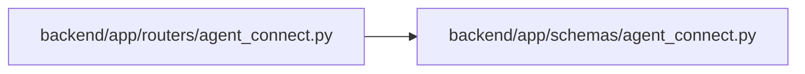

# agent_connect Module

**Path:** `backend/app/schemas/agent_connect.py`

## Description

Secret-free connection hint for agents that do not yet hold a key.

## Imports

| Source | Symbols |
|--------|---------|
| `__future__` | `annotations` |
| `pydantic` | `BaseModel`, `ConfigDict` |
| `typing` | `Literal` |

## Local dependency map

<!-- Auto-generated local dependency summary. Do not edit by hand. -->

### Internal neighbors

| Direction | Module |
|---|---|
| Inbound | [routers_agent_connect](../modules/routers_agent_connect.md) |

### External packages

| Language | Used packages | Undeclared packages |
|---|---:|---:|
| python | 1 | 0 |

## Classes

| Class | Line | Bases | Description |
|-------|------|-------|-------------|
| [AgentConnectModel](../entities/AgentConnectModel.md) | 9 | `BaseModel` | Reject undeclared fields so nothing extra is ever published here. |
| [AgentConnectCredential](../entities/AgentConnectCredential.md) | 15 | `AgentConnectModel` | Where an agent sends its key and where its runtime may read it from. |
| [AgentConnectRole](../entities/AgentConnectRole.md) | 26 | `AgentConnectModel` | The actor role and scopes an operator provisions for one role skill. |
| [AgentConnectResponse](../entities/AgentConnectResponse.md) | 36 | `AgentConnectModel` | How to reach this server as an agent; never holds credentials or instance data. |
