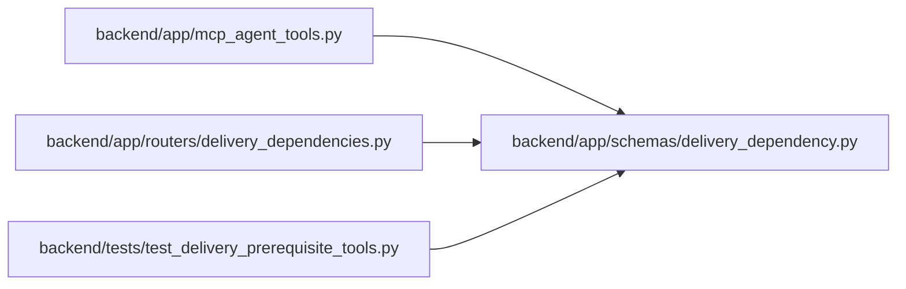

# delivery_dependency Module

**Path:** `backend/app/schemas/delivery_dependency.py`

## Description

Request bodies shared by the delivery prerequisite REST routes and MCP tools.

## Imports

| Source | Symbols |
|--------|---------|
| `pydantic` | `BaseModel`, `ConfigDict`, `Field` |
| `typing` | `Literal` |

## Local dependency map

<!-- Auto-generated local dependency summary. Do not edit by hand. -->

### Internal neighbors

| Direction | Module |
|---|---|
| Inbound | [mcp_agent_tools](../modules/mcp_agent_tools.md) |
| Inbound | [delivery_dependencies](../modules/delivery_dependencies.md) |
| Inbound | [test_delivery_prerequisite_tools](../modules/test_delivery_prerequisite_tools.md) |

### External packages

| Language | Used packages | Undeclared packages |
|---|---:|---:|
| python | 1 | 0 |

## Classes

| Class | Line | Bases | Description |
|-------|------|-------|-------------|
| [DeliveryDependencyInput](../entities/DeliveryDependencyInput.md) | 8 | `BaseModel` | Record a task or milestone prerequisite, optionally on a target branch. |
| [DeliveryDependencyRetarget](../entities/DeliveryDependencyRetarget.md) | 17 | `BaseModel` | Change the target branch of an existing task prerequisite; null keeps only the acceptance gate. |
