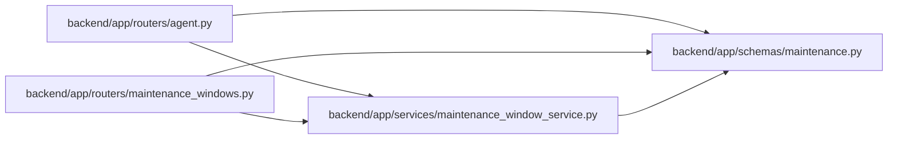

# maintenance Module

**Path:** `backend/app/schemas/maintenance.py`

## Description

Requests for coordinated control-plane maintenance windows.

## Imports

| Source | Symbols |
|--------|---------|
| `datetime` | `datetime` |
| `pydantic` | `BaseModel`, `ConfigDict`, `Field` |
| `typing` | `Literal`, `Optional` |

## Local dependency map

<!-- Auto-generated local dependency summary. Do not edit by hand. -->

### Internal neighbors

| Direction | Module |
|---|---|
| Inbound | [routers_agent](../modules/routers_agent.md) |
| Inbound | [maintenance_windows](../modules/maintenance_windows.md) |
| Inbound | [maintenance_window_service](../modules/maintenance_window_service.md) |

### External packages

| Language | Used packages | Undeclared packages |
|---|---:|---:|
| python | 1 | 0 |

## Classes

| Class | Line | Bases | Description |
|-------|------|-------|-------------|
| [MaintenanceWindowCreate](../entities/MaintenanceWindowCreate.md) | 9 | `BaseModel` | Announce one bounded window; it closes admission for new work at once. |
| [MaintenanceWindowNotice](../entities/MaintenanceWindowNotice.md) | 22 | `BaseModel` | An operator's record that a PM was told through another channel. |
| [MaintenanceWindowClose](../entities/MaintenanceWindowClose.md) | 32 | `BaseModel` | Close a begun window after the restart, or after a rollback. |
| [MaintenanceWindowCancel](../entities/MaintenanceWindowCancel.md) | 41 | `BaseModel` | Withdraw an announced window before it begins. |
| [MaintenanceOwnerAcknowledgement](../entities/MaintenanceOwnerAcknowledgement.md) | 49 | `BaseModel` | The live claim owner's acknowledgement, bound to its current fence. |
