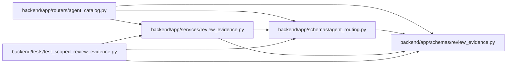

# review_evidence Module

**Path:** `backend/app/schemas/review_evidence.py`

## Description

Bounded, non-executable evidence prepared for one review of an immutable candidate.

Both issue forms identify one assessment, task version, artifact revision, submitted commit and reviewer binding. The source-and-tests form pairs each named offline test with the digest of its result. The source-only form requires an assessment that explicitly permits review from source alone.

## Imports

| Source | Symbols |
|--------|---------|
| `pydantic` | `AwareDatetime`, `BaseModel`, `ConfigDict`, `Field`, `field_validator`, `model_validator` |
| `typing` | `Annotated`, `Literal` |

## Local dependency map

<!-- Auto-generated local dependency summary. Do not edit by hand. -->

### Internal neighbors

| Direction | Module |
|---|---|
| Inbound | [agent_catalog](../modules/agent_catalog.md) |
| Inbound | [agent_routing](../modules/agent_routing.md) |
| Inbound | [services_review_evidence](../modules/services_review_evidence.md) |
| Inbound | [test_scoped_review_evidence](../modules/test_scoped_review_evidence.md) |

### External packages

| Language | Used packages | Undeclared packages |
|---|---:|---:|
| python | 1 | 0 |

## Classes

| Class | Kind | Line | Bases / Target | Description |
|-------|------|------|----------------|-------------|
| [Positive](../entities/Positive.md) | Type alias | 14 | `Annotated[int, Field(strict=True, ge=1)]` | — |
| [Sha256](../entities/Sha256.md) | Type alias | 15 | `Annotated[str, Field(pattern='^[0-9a-f]{64}$')]` | — |
| [ReviewTestEvidence](../entities/ReviewTestEvidence.md) | Pydantic model | 18 | `BaseModel` | — |
| [ReviewEvidenceIssue](../entities/ReviewEvidenceIssue.md) | Pydantic model | 31 | `BaseModel` | The operator attests to the manifest of material delivered to the specified verifier. |
| [ReviewEvidenceRevocation](../entities/ReviewEvidenceRevocation.md) | Pydantic model | 58 | `BaseModel` | — |
| [ReviewEvidenceCommand](../entities/ReviewEvidenceCommand.md) | Type alias | 64 | `Annotated[ReviewEvidenceIssue \| ReviewEvidenceRevocation, Field(discriminator='action')]` | — |
| [ScopedReviewEvidence](../entities/ScopedReviewEvidence.md) | Pydantic model | 69 | `BaseModel` | Compact owner and validity information returned by a scoped verification preview. |
