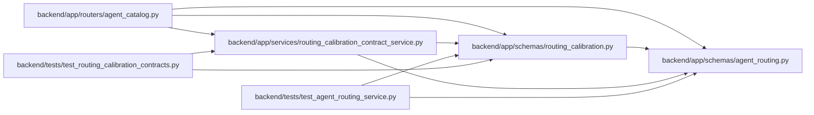

# routing_calibration Module

**Path:** `backend/app/schemas/routing_calibration.py`

## Description

Contracts for the calibration terms under which performance history may inform routing.

A calibration contract names the qualification keys it covers, the sample
bounds and decay any calibration must respect, the bias review that preceded
it and the accountable approver. Storing or approving a contract changes no
routing decision: routing reads only whether an approved contract exists.

## Imports

| Source | Symbols |
|--------|---------|
| `__future__` | `annotations` |
| `app.schemas.agent_routing` | `MAX_ROUTING_TAGS`, `PositiveRevision`, `RoutingDigest`, `RoutingKey` |
| `datetime` | `UTC`, `datetime` |
| `hashlib` | `hashlib` |
| `json` | `json` |
| `pydantic` | `BaseModel`, `ConfigDict`, `Field`, `field_validator`, `model_validator` |
| `typing` | `Any`, `Literal` |

## Local dependency map

<!-- Auto-generated local dependency summary. Do not edit by hand. -->

### Internal neighbors

| Direction | Module |
|---|---|
| Inbound | [agent_catalog](../modules/agent_catalog.md) |
| Inbound | [routing_calibration_contract_service](../modules/routing_calibration_contract_service.md) |
| Inbound | [test_agent_routing_service](../modules/test_agent_routing_service.md) |
| Inbound | [test_routing_calibration_contracts](../modules/test_routing_calibration_contracts.md) |
| Outbound | [agent_routing](../modules/agent_routing.md) |

### External packages

| Language | Used packages | Undeclared packages |
|---|---:|---:|
| python | 1 | 0 |

## Classes

| Class | Kind | Line | Bases / Target | Description |
|-------|------|------|----------------|-------------|
| [CalibrationContractState](../entities/CalibrationContractState.md) | Type alias | 22 | `Literal['submitted', 'approved']` | — |
| [CalibrationContractAction](../entities/CalibrationContractAction.md) | Type alias | 23 | `Literal['submit', 'approve']` | — |
| [CalibrationDecayMethod](../entities/CalibrationDecayMethod.md) | Type alias | 24 | `Literal['exponential', 'linear', 'window']` | — |
| [_CalibrationModel](../entities/CalibrationModel.md) | Pydantic model | 31 | `BaseModel` | — |
| [CalibrationSampleBounds](../entities/CalibrationSampleBounds.md) | Pydantic model | 46 | `_CalibrationModel` | How many observations, and how old, a calibration may use per model and key. |
| [CalibrationDecay](../entities/CalibrationDecay.md) | Pydantic model | 60 | `_CalibrationModel` | How an older observation's weight falls. |
| [CalibrationBiasReview](../entities/CalibrationBiasReview.md) | Pydantic model | 71 | `_CalibrationModel` | The record of the bias review the terms were checked against. |
| [RoutingCalibrationContractTerms](../entities/RoutingCalibrationContractTerms.md) | Pydantic model | 108 | `_CalibrationModel` | The complete terms of one contract revision; every field is required. |
| [RoutingCalibrationContractSubmit](../entities/RoutingCalibrationContractSubmit.md) | Pydantic model | 159 | `RoutingCalibrationContractTerms` | Submit a new contract under a key that names no contract yet. |
| [RoutingCalibrationContractRevise](../entities/RoutingCalibrationContractRevise.md) | Pydantic model | 170 | `RoutingCalibrationContractTerms` | Submit complete new terms for an existing contract; any approval lapses. |
| [RoutingCalibrationContractApprove](../entities/RoutingCalibrationContractApprove.md) | Pydantic model | 176 | `_CalibrationModel` | Approve the current submitted terms, named by revision and digest. |
| [CalibrationContractActor](../entities/CalibrationContractActor.md) | Pydantic model | 194 | `_CalibrationModel` | Who issued a command: the operator's admin key, or an agent actor. |
| [RoutingCalibrationContractResponse](../entities/RoutingCalibrationContractResponse.md) | Pydantic model | 201 | `_CalibrationModel` | The current revision of one contract. |
| [RoutingCalibrationContractRevisionResponse](../entities/RoutingCalibrationContractRevisionResponse.md) | Pydantic model | 251 | `_CalibrationModel` | One append-only command on a contract, with its terms and reason. |
| [RoutingCalibrationContractDetail](../entities/RoutingCalibrationContractDetail.md) | Pydantic model | 267 | `RoutingCalibrationContractResponse` | One contract with every revision it has had. |
| [RoutingCalibrationContractListResponse](../entities/RoutingCalibrationContractListResponse.md) | Pydantic model | 273 | `_CalibrationModel` | The deployment's contracts, and whether routing may treat any as approved. |

## Functions

| Function | Signature | Decorators | Description |
|----------|-----------|------------|-------------|
| `_clean_text` | `(value: str \| None, *, label: str) -> str \| None` | — | — |
