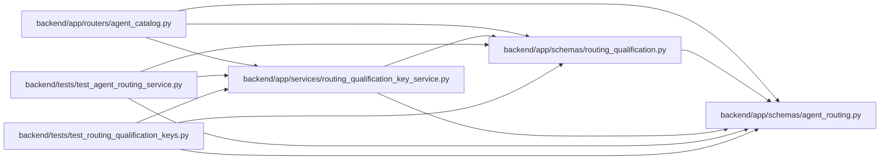

# routing_qualification Module

**Path:** `backend/app/schemas/routing_qualification.py`

## Description

Contracts for the deployment's governed qualification key registry.

A declared key extends the vocabulary that catalog entries and task routing
requirements may name. The built-in routing skill keys stay fixed in code and
are listed beside the registry, never stored in it.

## Imports

| Source | Symbols |
|--------|---------|
| `__future__` | `annotations` |
| `app.schemas.agent_routing` | `PositiveRevision`, `RoutingKey` |
| `datetime` | `datetime` |
| `pydantic` | `BaseModel`, `ConfigDict`, `Field`, `field_validator`, `model_validator` |
| `typing` | `Literal` |

## Local dependency map

<!-- Auto-generated local dependency summary. Do not edit by hand. -->

### Internal neighbors

| Direction | Module |
|---|---|
| Inbound | [agent_catalog](../modules/agent_catalog.md) |
| Inbound | [routing_qualification_key_service](../modules/routing_qualification_key_service.md) |
| Inbound | [test_agent_routing_service](../modules/test_agent_routing_service.md) |
| Inbound | [test_routing_qualification_keys](../modules/test_routing_qualification_keys.md) |
| Outbound | [agent_routing](../modules/agent_routing.md) |

### External packages

| Language | Used packages | Undeclared packages |
|---|---:|---:|
| python | 1 | 0 |

## Classes

| Class | Kind | Line | Bases / Target | Description |
|-------|------|------|----------------|-------------|
| [QualificationKeyState](../entities/QualificationKeyState.md) | Type alias | 18 | `Literal['active', 'retired']` | — |
| [QualificationKeyAction](../entities/QualificationKeyAction.md) | Type alias | 19 | `Literal['declare', 'revise', 'retire']` | — |
| [_RegistryModel](../entities/RegistryModel.md) | Pydantic model | 25 | `BaseModel` | — |
| [RoutingQualificationKeyDeclare](../entities/schemas_routing_qualification_RoutingQualificationKeyDeclare.md) | Pydantic model | 40 | `_RegistryModel` | Declare a new key, or bring back a retired one under the same name. |
| [RoutingQualificationKeyRevise](../entities/schemas_routing_qualification_RoutingQualificationKeyRevise.md) | Pydantic model | 63 | `_RegistryModel` | Change an active key's label or description; the key itself never changes. |
| [RoutingQualificationKeyRetire](../entities/RoutingQualificationKeyRetire.md) | Pydantic model | 89 | `_RegistryModel` | Retire an active key that no catalog entry or current task requirement names. |
| [RoutingQualificationKeyResponse](../entities/RoutingQualificationKeyResponse.md) | Pydantic model | 95 | `_RegistryModel` | The current state of one declared key. |
| [RoutingQualificationKeyRevisionResponse](../entities/RoutingQualificationKeyRevisionResponse.md) | Pydantic model | 109 | `_RegistryModel` | One append-only change to a declared key, with its reason. |
| [QualificationKeyCatalogReference](../entities/QualificationKeyCatalogReference.md) | Pydantic model | 124 | `_RegistryModel` | A catalog entry that holds the key. |
| [RoutingQualificationKeyUsage](../entities/schemas_routing_qualification_RoutingQualificationKeyUsage.md) | Pydantic model | 132 | `_RegistryModel` | Catalog entries and tasks whose current routing assessment name the key. |
| [RoutingQualificationKeyDetail](../entities/schemas_routing_qualification_RoutingQualificationKeyDetail.md) | Pydantic model | 153 | `RoutingQualificationKeyResponse` | One key with its revision history and current usage. |
| [RoutingQualificationKeyRegistryResponse](../entities/RoutingQualificationKeyRegistryResponse.md) | Pydantic model | 160 | `_RegistryModel` | The built-in keys routing always accepts, and the deployment's declared keys. |

## Functions

| Function | Signature | Decorators | Description |
|----------|-----------|------------|-------------|
| `_strip_text` | `(value: str \| None, *, label: str, allow_empty: bool) -> str \| None` | — | — |
