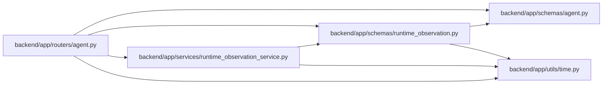

# runtime_observation Module

**Path:** `backend/app/schemas/runtime_observation.py`

## Description

Advisory runtime observation contracts.

## Imports

| Source | Symbols |
|--------|---------|
| `app.schemas.agent` | `check_harness_identity` |
| `app.utils.time` | `as_utc`, `utc_now` |
| `datetime` | `datetime`, `timedelta` |
| `pydantic` | `BaseModel`, `ConfigDict`, `Field`, `field_validator`, `model_validator` |
| `typing` | `Literal`, `Optional` |

## Local dependency map

<!-- Auto-generated local dependency summary. Do not edit by hand. -->

### Internal neighbors

| Direction | Module |
|---|---|
| Inbound | [routers_agent](../modules/routers_agent.md) |
| Inbound | [runtime_observation_service](../modules/runtime_observation_service.md) |
| Outbound | [schemas_agent](../modules/schemas_agent.md) |
| Outbound | [time](../modules/time.md) |

### External packages

| Language | Used packages | Undeclared packages |
|---|---:|---:|
| python | 1 | 0 |

## Classes

| Class | Kind | Line | Bases / Target | Description |
|-------|------|------|----------------|-------------|
| [ObservationKind](../entities/ObservationKind.md) | Type alias | 11 | `Literal['session_active', 'session_idle', 'session_ended', 'model_observed']` | — |
| [AgentRuntimeObservationCreate](../entities/AgentRuntimeObservationCreate.md) | Pydantic model | 14 | `BaseModel` | One thing an independent observer saw of a runtime session. |
| [AgentRuntimeObservationResponse](../entities/AgentRuntimeObservationResponse.md) | Pydantic model | 53 | `BaseModel` | A recorded observation. It is advisory and never affects dispatch. |
| [AgentRuntimeObservationCleanupResponse](../entities/AgentRuntimeObservationCleanupResponse.md) | Pydantic model | 73 | `BaseModel` | — |
