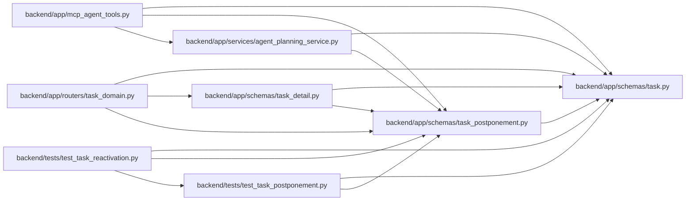

# task_postponement Module

**Path:** `backend/app/schemas/task_postponement.py`

## Description

Postpone and reactivate commands and the postponement record they return.

## Imports

| Source | Symbols |
|--------|---------|
| `app.schemas.task` | `TaskResponse` |
| `datetime` | `date`, `datetime` |
| `pydantic` | `BaseModel`, `ConfigDict`, `Field`, `field_validator`, `model_validator` |
| `typing` | `Literal` |

## Local dependency map

<!-- Auto-generated local dependency summary. Do not edit by hand. -->

### Internal neighbors

| Direction | Module |
|---|---|
| Inbound | [mcp_agent_tools](../modules/mcp_agent_tools.md) |
| Inbound | [routers_task_domain](../modules/routers_task_domain.md) |
| Inbound | [task_detail](../modules/task_detail.md) |
| Inbound | [agent_planning_service](../modules/agent_planning_service.md) |
| Inbound | [test_task_postponement](../modules/test_task_postponement.md) |
| Inbound | [test_task_reactivation](../modules/test_task_reactivation.md) |
| Outbound | [schemas_task](../modules/schemas_task.md) |

### External packages

| Language | Used packages | Undeclared packages |
|---|---:|---:|
| python | 1 | 0 |

## Classes

| Class | Kind | Line | Bases / Target | Description |
|-------|------|------|----------------|-------------|
| [RequirementKind](../entities/RequirementKind.md) | Type alias | 10 | `Literal['predecessor_accepted', 'date', 'owner_decision', 'linked_resolved']` | — |
| [ReactivationRequirementInput](../entities/schemas_task_postponement_ReactivationRequirementInput.md) | Pydantic model | 24 | `BaseModel` | One condition that must hold before postponed work resumes. |
| [TaskPostponeRequest](../entities/TaskPostponeRequest.md) | Pydantic model | 60 | `BaseModel` | Stop planned, active or resolved work until its reactivation requirements are met. |
| [TaskReactivateRequest](../entities/TaskReactivateRequest.md) | Pydantic model | 83 | `BaseModel` | Return postponed work to planned, or to resolved when it was postponed after resolution. |
| [OwnerDecisionRequest](../entities/OwnerDecisionRequest.md) | Pydantic model | 97 | `BaseModel` | Record that the owner made the decision an owner_decision requirement waits for. |
| [ReactivationRequirementResponse](../entities/ReactivationRequirementResponse.md) | Pydantic model | 115 | `BaseModel` | — |
| [PostponementRelease](../entities/PostponementRelease.md) | Pydantic model | 127 | `BaseModel` | Execution ownership the postponement ended through the fenced release. |
| [TaskPostponementRecord](../entities/schemas_task_postponement_TaskPostponementRecord.md) | Pydantic model | 136 | `BaseModel` | — |
| [TaskPostponementResponse](../entities/schemas_task_postponement_TaskPostponementResponse.md) | Pydantic model | 158 | `BaseModel` | — |

## Functions

| Function | Signature | Decorators | Description |
|----------|-----------|------------|-------------|
| `_stripped` | `(value: str \| None) -> str \| None` | — | — |
