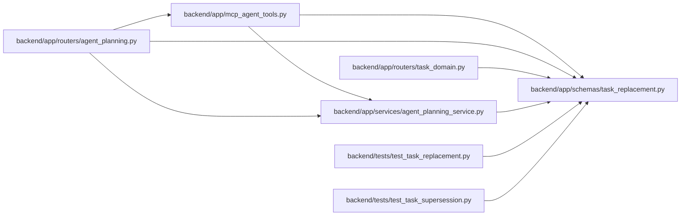

# task_replacement Module

**Path:** `backend/app/schemas/task_replacement.py`

## Description

Clean-replacement disposition commands and their auditable projection.

## Imports

| Source | Symbols |
|--------|---------|
| `datetime` | `datetime` |
| `pydantic` | `BaseModel`, `ConfigDict`, `Field`, `field_validator` |
| `typing` | `Literal` |

## Local dependency map

<!-- Auto-generated local dependency summary. Do not edit by hand. -->

### Internal neighbors

| Direction | Module |
|---|---|
| Inbound | [mcp_agent_tools](../modules/mcp_agent_tools.md) |
| Inbound | [routers_agent_planning](../modules/routers_agent_planning.md) |
| Inbound | [routers_task_domain](../modules/routers_task_domain.md) |
| Inbound | [agent_planning_service](../modules/agent_planning_service.md) |
| Inbound | [test_task_replacement](../modules/test_task_replacement.md) |
| Inbound | [test_task_supersession](../modules/test_task_supersession.md) |

### External packages

| Language | Used packages | Undeclared packages |
|---|---:|---:|
| python | 1 | 0 |

## Classes

| Class | Line | Bases | Description |
|-------|------|-------|-------------|
| [TaskReplacementCreate](../entities/TaskReplacementCreate.md) | 9 | `BaseModel` | Replace an unaccepted original with a fresh task built from a clean base. |
| [TaskSupersessionCreate](../entities/TaskSupersessionCreate.md) | 41 | `BaseModel` | Record that work already closed or accepted delivered this original's deliverable. |
| [ReplacementContributor](../entities/ReplacementContributor.md) | 61 | `BaseModel` | One recorded attempt with exactly the attribution the server holds for it. |
| [ReplacementDecision](../entities/ReplacementDecision.md) | 74 | `BaseModel` | — |
| [ReplacementReviewPolicy](../entities/ReplacementReviewPolicy.md) | 82 | `BaseModel` | — |
| [ReplacementMovedDependency](../entities/ReplacementMovedDependency.md) | 87 | `BaseModel` | — |
| [ReplacementOriginal](../entities/ReplacementOriginal.md) | 93 | `BaseModel` | — |
| [ReplacementCandidate](../entities/ReplacementCandidate.md) | 104 | `BaseModel` | — |
| [ReplacementTask](../entities/ReplacementTask.md) | 111 | `BaseModel` | — |
| [ReplacementAcceptance](../entities/ReplacementAcceptance.md) | 120 | `BaseModel` | The deliverable is counted once: only the replacement can be accepted. |
| [TaskReplacementResponse](../entities/TaskReplacementResponse.md) | 129 | `BaseModel` | — |
