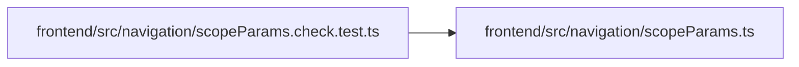

# scopeParams.check.test Module

**Path:** `frontend/src/navigation/scopeParams.check.test.ts`

## Description

_Auto-generated from `frontend/src/navigation/scopeParams.check.test.ts`._

## Imports

| Source | Symbols | Type-only | Runtime emission |
|--------|---------|-----------|------------------|
| `./scopeParams.ts` | `formatScope`, `parseScope` | — | compiler-dependent |
| `node:assert` | `assert` | — | compiler-dependent |
| `node:test` | `describe`, `it` | — | compiler-dependent |

## Module Signals

| Signal | Values |
|--------|--------|
| Constants | `parseCases`, `formatCases`, `roundTripCases` |
| Module calls | `describe`, `describe`, `describe` |

## Local dependency map

<!-- Auto-generated local dependency summary. Do not edit by hand. -->

### Internal neighbors

| Direction | Module |
|---|---|
| Outbound | [scopeParams](../modules/scopeParams.md) |

## Classes

| Class | Kind | Line | Bases / Target | Description |
|-------|------|------|----------------|-------------|
| [Scope](../entities/scopeParams.check.test_Scope.md) | Type alias | 12 | `{ project: number \| 'all'; iteration: number \| 'backlog' }` | — |
| [ParsedScope](../entities/scopeParams.check.test_ParsedScope.md) | Type alias | 13 | `Partial<Scope>` | — |
