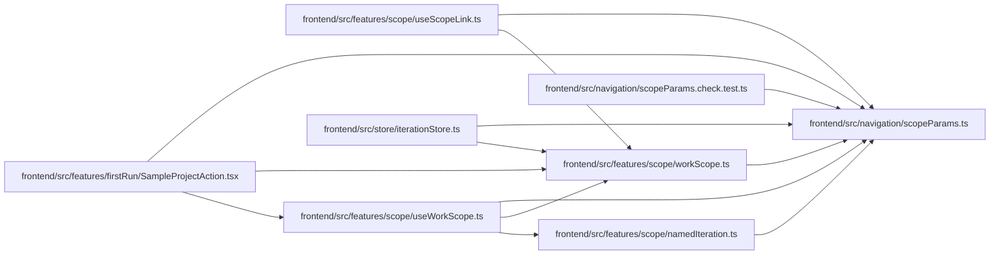

# scopeParams Module

**Path:** `frontend/src/navigation/scopeParams.ts`

## Description

_Auto-generated from `frontend/src/navigation/scopeParams.ts`._

## Module Signals

| Signal | Values |
|--------|--------|
| Exports | `formatScope`, `parseScope` |

## Local dependency map

<!-- Auto-generated local dependency summary. Do not edit by hand. -->

### Internal neighbors

| Direction | Module |
|---|---|
| Inbound | [SampleProjectAction](../modules/SampleProjectAction.md) |
| Inbound | [namedIteration](../modules/namedIteration.md) |
| Inbound | [useScopeLink](../modules/useScopeLink.md) |
| Inbound | [useWorkScope](../modules/useWorkScope.md) |
| Inbound | [workScope](../modules/workScope.md) |
| Inbound | [scopeParams.check.test](../modules/scopeParams.check.test.md) |
| Inbound | [iterationStore](../modules/iterationStore.md) |

## Classes

| Class | Kind | Line | Bases / Target | Description |
|-------|------|------|----------------|-------------|
| [Scope](../entities/scopeParams_Scope.md) | Type alias | 1 | `{ project: number \| 'all'; iteration: number \| 'backlog' }` | — |
| [ParsedScope](../entities/scopeParams_ParsedScope.md) | Type alias | 2 | `Partial<Scope>` | — |

## Functions

| Function | Signature | Decorators | Description |
|----------|-----------|------------|-------------|
| `parseScope` | `(search: string) -> ParsedScope` | — | — |
| `formatScope` | `(scope: Scope, search: string) -> string` | — | — |
