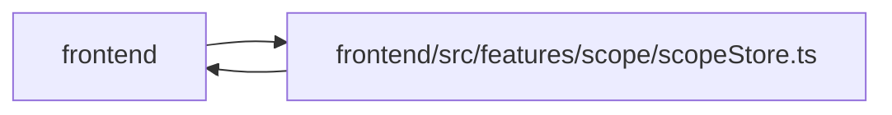

# scopeStore Module

**Path:** `frontend/src/features/scope/scopeStore.ts`

## Description

_Auto-generated from `frontend/src/features/scope/scopeStore.ts`._

## Imports

| Source | Symbols | Type-only | Runtime emission |
|--------|---------|-----------|------------------|
| `./workScope` | `PartialWorkScope`, `ScopeIteration`, `ScopeProject` | Declaration | erased |
| `zustand` | `create` | — | compiler-dependent |
| `zustand/middleware` | `createJSONStorage`, `persist` | — | compiler-dependent |

## Module Signals

| Signal | Values |
|--------|--------|
| Exports | `LEGACY_ITERATION_STORAGE_KEY`, `RememberedScope`, `SCOPE_STORAGE_KEY`, `migrateLegacyIterationStorage`, `useScopeStore` |
| Constants | `SCOPE_STORAGE_KEY`, `LEGACY_ITERATION_STORAGE_KEY`, `useScopeStore` |
| Module calls | `migrateLegacyIterationStorage`, `useScopeStore = create<ScopeStore>()` |

## Local dependency map

<!-- Auto-generated local dependency summary. Do not edit by hand. -->
This graph shows full source coupling. Type dependencies can be erased; compiler-dependent cycle groups are runtime candidates, not confirmed initialization cycles.

> Module-level dependencies exceed the generated-diagram limits, so the diagram and table below group them by top-level package. Counts report the number of module neighbors in each package.

### Internal neighbors

| Direction | Module |
|---|---|
| Inbound | `frontend` (29) |
| Outbound | `frontend` (1) |

### External packages

| Language | Used packages | Undeclared packages |
|---|---:|---:|
| typescript | 1 | 0 |

> All 30 module neighbor(s) are summarized by package because the module-level view exceeds the 12-node limit.

## Classes

| Class | Kind | Line | Bases / Target | Description |
|-------|------|------|----------------|-------------|
| [RememberedScope](../entities/RememberedScope.md) | Interface | 10 | — | — |
| [ScopeStore](../entities/ScopeStore.md) | Interface | 15 | `RememberedScope` | — |

## Functions

| Function | Signature | Decorators | Description |
|----------|-----------|------------|-------------|
| `migrateLegacyIterationStorage` | `(storage: Storage \| undefined = browserStorage()) -> void` | — | Carries the iteration remembered under the old key over to the scope key, then removes |
