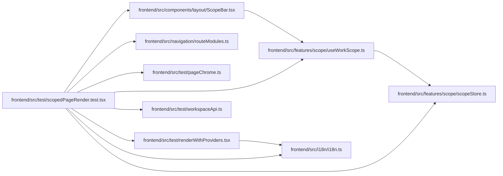

# scopedPageRender.test Module

**Path:** `frontend/src/test/scopedPageRender.test.tsx`

## Description

_Auto-generated from `frontend/src/test/scopedPageRender.test.tsx`._

## Imports

| Source | Symbols | Type-only | Runtime emission |
|--------|---------|-----------|------------------|
| `../components/layout/ScopeBar` | `ScopeBar` | — | compiler-dependent |
| `../features/scope/scopeStore` | `useScopeStore` | — | compiler-dependent |
| `../features/scope/useWorkScope` | `useWorkScope` | — | compiler-dependent |
| `../i18n/i18n` | `i18n` | — | compiler-dependent |
| `../navigation/routeModules` | `routeModuleLoaders` | — | compiler-dependent |
| `./pageChrome` | `expectPageChrome` | — | compiler-dependent |
| `./renderWithProviders` | `renderWithProviders` | — | compiler-dependent |
| `./workspaceApi` | `installWorkspaceApi` | — | compiler-dependent |
| `@testing-library/react` | `act`, `screen`, `waitFor`, `within` | — | compiler-dependent |
| `react-router-dom` | `Route`, `Routes`, `Outlet` | — | compiler-dependent |
| `vitest` | `afterEach`, `beforeEach`, `describe`, `expect`, `it`, `vi` | — | compiler-dependent |

## Module Signals

| Signal | Values |
|--------|--------|
| Constants | `SCOPED_PAGES`, `SCOPES` |
| Module calls | `describe` |

## Local dependency map

<!-- Auto-generated local dependency summary. Do not edit by hand. -->

### Internal neighbors

| Direction | Module |
|---|---|
| Outbound | [ScopeBar](../modules/ScopeBar.md) |
| Outbound | [scopeStore](../modules/scopeStore.md) |
| Outbound | [useWorkScope](../modules/useWorkScope.md) |
| Outbound | [i18n](../modules/i18n.md) |
| Outbound | [routeModules](../modules/routeModules.md) |
| Outbound | [pageChrome](../modules/pageChrome.md) |
| Outbound | [renderWithProviders](../modules/renderWithProviders.md) |
| Outbound | [workspaceApi](../modules/workspaceApi.md) |

### External packages

| Language | Used packages | Undeclared packages |
|---|---:|---:|
| typescript | 3 | 0 |
