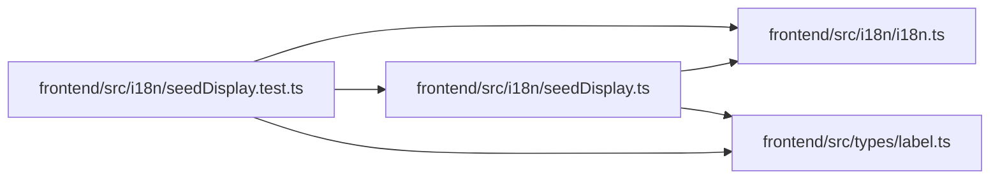

# seedDisplay.test Module

**Path:** `frontend/src/i18n/seedDisplay.test.ts`

## Description

_Auto-generated from `frontend/src/i18n/seedDisplay.test.ts`._

## Imports

| Source | Symbols | Type-only | Runtime emission |
|--------|---------|-----------|------------------|
| `../types/label` | `LabelGroupBrief` | Declaration | erased |
| `./i18n` | `changeAppLanguage` | — | compiler-dependent |
| `./seedDisplay` | `labelDisplay`, `labelGroupDisplay` | — | compiler-dependent |
| `vitest` | `afterEach`, `describe`, `expect`, `it` | — | compiler-dependent |

## Module Signals

| Signal | Values |
|--------|--------|
| Module calls | `describe` |

## Local dependency map

<!-- Auto-generated local dependency summary. Do not edit by hand. -->
This graph shows full source coupling. Type dependencies can be erased; compiler-dependent cycle groups are runtime candidates, not confirmed initialization cycles.

### Internal neighbors

| Direction | Module |
|---|---|
| Outbound | [i18n](../modules/i18n.md) |
| Outbound | [seedDisplay](../modules/seedDisplay.md) |
| Outbound | [types_label](../modules/types_label.md) |

### External packages

| Language | Used packages | Undeclared packages |
|---|---:|---:|
| typescript | 1 | 0 |
