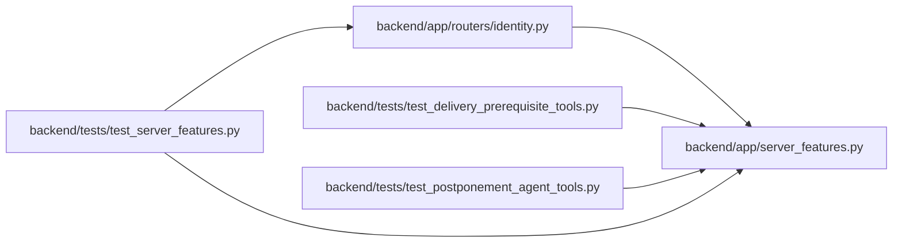

# server_features Module

**Path:** `backend/app/server_features.py`

## Description

Server features a client can detect before it holds a credential.

A client such as a read-only dashboard reads this list from ``GET /api/auth/me``
to choose what to use, instead of comparing versions or commits. A name is
stable once published; a server without a feature does not list it.

## Local dependency map

<!-- Auto-generated local dependency summary. Do not edit by hand. -->

### Internal neighbors

| Direction | Module |
|---|---|
| Inbound | [routers_identity](../modules/routers_identity.md) |
| Inbound | [test_delivery_prerequisite_tools](../modules/test_delivery_prerequisite_tools.md) |
| Inbound | [test_postponement_agent_tools](../modules/test_postponement_agent_tools.md) |
| Inbound | [test_server_features](../modules/test_server_features.md) |
