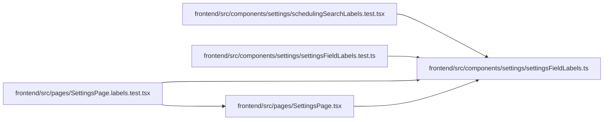

# settingsFieldLabels Module

**Path:** `frontend/src/components/settings/settingsFieldLabels.ts`

## Description

_Auto-generated from `frontend/src/components/settings/settingsFieldLabels.ts`._

## Module Signals

| Signal | Values |
|--------|--------|
| Exports | `SETTINGS_FIELD_LABEL_KEYS`, `SettingsSectionId` |
| Constants | `SETTINGS_FIELD_LABEL_KEYS` |

## Local dependency map

<!-- Auto-generated local dependency summary. Do not edit by hand. -->
This graph shows full source coupling. Type dependencies can be erased; compiler-dependent cycle groups are runtime candidates, not confirmed initialization cycles.

### Internal neighbors

| Direction | Module |
|---|---|
| Inbound | [schedulingSearchLabels.test](../modules/schedulingSearchLabels.test.md) |
| Inbound | [settingsFieldLabels.test](../modules/settingsFieldLabels.test.md) |
| Inbound | [SettingsPage.labels.test](../modules/SettingsPage.labels.test.md) |
| Inbound | [SettingsPage](../modules/SettingsPage.md) |

## Classes

| Class | Kind | Line | Bases / Target | Description |
|-------|------|------|----------------|-------------|
| [SettingsSectionId](../entities/SettingsSectionId.md) | Type alias | 1 | <pre><code>&#124; &#39;theme&#39; &#124; &#39;shortcuts&#39;&#10;    &#124; &#39;language&#39; &#124; &#39;work&#95;calendar&#39; &#124; &#39;scheduling&#39; &#124; &#39;templates&#95;labels&#39; &#124; &#39;notifications&#39;&#10;    &#124; &#39;github&#39; &#124; &#39;webhooks&#39; &#124; &#39;web&#95;intake&#39; &#124; &#39;ai&#95;provider&#39;&#10;    &#124; &#39;access&#39; &#124; &#39;runtime&#39; &#124; &#39;about&#39;</code></pre> | — |
