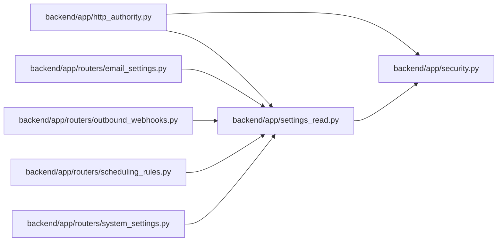

# settings_read Module

**Path:** `backend/app/settings_read.py`

## Description

Read-only settings for people without the admin key.

Workspace members and trusted-local sessions may read the settings that explain
how the workspace behaves. Every change still needs the admin key. Values that
are not secrets but are still sensitive are withheld from these readers:
endpoint URLs are reduced to their host, and the mail host and login, webhook
header values, and delivery response bodies and errors are left out. Secrets
are never returned to anyone; responses only say whether one is set.

## Imports

| Source | Symbols |
|--------|---------|
| `app.security` | `ADMIN_API_KEY_HEADER`, `require_admin_api_key` |
| `fastapi` | `Header`, `Request` |
| `typing` | `Annotated`, `Optional` |
| `urllib.parse` | `urlsplit` |

## Local dependency map

<!-- Auto-generated local dependency summary. Do not edit by hand. -->

### Internal neighbors

| Direction | Module |
|---|---|
| Inbound | [http_authority](../modules/http_authority.md) |
| Inbound | [routers_email_settings](../modules/routers_email_settings.md) |
| Inbound | [outbound_webhooks](../modules/outbound_webhooks.md) |
| Inbound | [routers_scheduling_rules](../modules/routers_scheduling_rules.md) |
| Inbound | [routers_system_settings](../modules/routers_system_settings.md) |
| Outbound | [security](../modules/security.md) |

### External packages

| Language | Used packages | Undeclared packages |
|---|---:|---:|
| python | 1 | 0 |

## Functions

| Function | Signature | Decorators | Description |
|----------|-----------|------------|-------------|
| `settings_reader` | `(authority) -> bool` | — | A person who may read settings without the admin key. |
| `withholds` | `(authority) -> bool` | — | Whether a settings response must leave out sensitive values. |
| `host_only` | `(url: str \| None) -> str` | — | — |
| `require_settings_access` | *(async)* `(request: Request, api_key: Annotated[Optional[str], Header(alias=ADMIN_API_KEY_HEADER)] = None) -> None` | — | Let settings readers read; every other request needs the admin key. |
| `redact_system_settings` | `(response)` | — | — |
| `redact_email_settings` | `(response)` | — | — |
| `redact_webhook_target` | `(response)` | — | — |
| `redact_webhook_delivery` | `(response)` | — | — |
