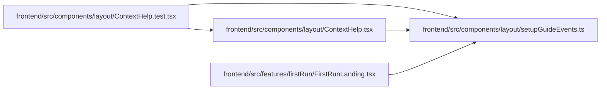

# setupGuideEvents Module

**Path:** `frontend/src/components/layout/setupGuideEvents.ts`

## Description

_Auto-generated from `frontend/src/components/layout/setupGuideEvents.ts`._

## Module Signals

| Signal | Values |
|--------|--------|
| Exports | `OPEN_SETUP_GUIDE_EVENT`, `openSetupGuide` |
| Constants | `OPEN_SETUP_GUIDE_EVENT` |

## Local dependency map

<!-- Auto-generated local dependency summary. Do not edit by hand. -->

### Internal neighbors

| Direction | Module |
|---|---|
| Inbound | [ContextHelp.test](../modules/ContextHelp.test.md) |
| Inbound | [ContextHelp](../modules/ContextHelp.md) |
| Inbound | [FirstRunLanding](../modules/FirstRunLanding.md) |

## Functions

| Function | Signature | Decorators | Description |
|----------|-----------|------------|-------------|
| `openSetupGuide` | `()` | — | — |
