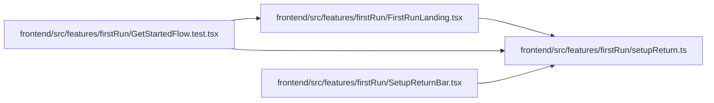

# setupReturn Module

**Path:** `frontend/src/features/firstRun/setupReturn.ts`

## Description

_Auto-generated from `frontend/src/features/firstRun/setupReturn.ts`._

## Imports

| Source | Symbols | Type-only | Runtime emission |
|--------|---------|-----------|------------------|
| `zustand` | `create` | — | compiler-dependent |

## Module Signals

| Signal | Values |
|--------|--------|
| Exports | `SETUP_RETURN_KEY`, `useSetupReturn` |
| Constants | `SETUP_RETURN_KEY`, `useSetupReturn` |
| Module calls | `useSetupReturn = create` |

## Local dependency map

<!-- Auto-generated local dependency summary. Do not edit by hand. -->

### Internal neighbors

| Direction | Module |
|---|---|
| Inbound | [FirstRunLanding](../modules/FirstRunLanding.md) |
| Inbound | [GetStartedFlow.test](../modules/GetStartedFlow.test.md) |
| Inbound | [SetupReturnBar](../modules/SetupReturnBar.md) |

### External packages

| Language | Used packages | Undeclared packages |
|---|---:|---:|
| typescript | 1 | 0 |

## Classes

| Class | Kind | Line | Bases / Target | Description |
|-------|------|------|----------------|-------------|
| [SetupReturn](../entities/SetupReturn.md) | Interface | 35 | — | — |
