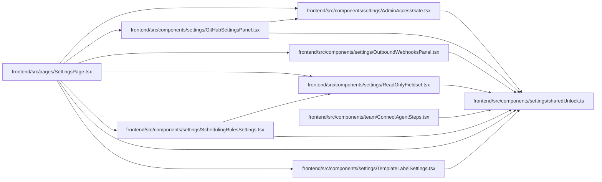

# sharedUnlock Module

**Path:** `frontend/src/components/settings/sharedUnlock.ts`

## Description

_Auto-generated from `frontend/src/components/settings/sharedUnlock.ts`._

## Imports

| Source | Symbols | Type-only | Runtime emission |
|--------|---------|-----------|------------------|
| `react` | `createContext`, `useContext` | — | compiler-dependent |

## Module Signals

| Signal | Values |
|--------|--------|
| Exports | `SettingsReadOnly`, `SettingsReadOnlyContext`, `SharedUnlock`, `SharedUnlockContext`, `useSettingsReadOnly`, `useSharedUnlock` |
| Constants | `SharedUnlockContext`, `SettingsReadOnlyContext` |
| Module calls | `SharedUnlockContext = createContext`, `SettingsReadOnlyContext = createContext` |

## Local dependency map

<!-- Auto-generated local dependency summary. Do not edit by hand. -->

### Internal neighbors

| Direction | Module |
|---|---|
| Inbound | [AdminAccessGate](../modules/AdminAccessGate.md) |
| Inbound | [GitHubSettingsPanel](../modules/GitHubSettingsPanel.md) |
| Inbound | [OutboundWebhooksPanel](../modules/OutboundWebhooksPanel.md) |
| Inbound | [ReadOnlyFieldset](../modules/ReadOnlyFieldset.md) |
| Inbound | [SchedulingRulesSettings](../modules/SchedulingRulesSettings.md) |
| Inbound | [TemplateLabelSettings](../modules/TemplateLabelSettings.md) |
| Inbound | [ConnectAgentSteps](../modules/ConnectAgentSteps.md) |
| Inbound | [SettingsPage](../modules/SettingsPage.md) |

### External packages

| Language | Used packages | Undeclared packages |
|---|---:|---:|
| typescript | 1 | 0 |

## Classes

| Class | Kind | Line | Bases / Target | Description |
|-------|------|------|----------------|-------------|
| [SharedUnlock](../entities/SharedUnlock.md) | Interface | 8 | — | Set by a page that shows one Unlock editing control for all of its protected |
| [SettingsReadOnly](../entities/SettingsReadOnly.md) | Interface | 22 | — | Set by a gate around content that disables its own editing controls while |

## Functions

| Function | Signature | Decorators | Description |
|----------|-----------|------------|-------------|
| `useSharedUnlock` | `()` | — | — |
| `useSettingsReadOnly` | `()` | — | Null when the content may be edited. |
