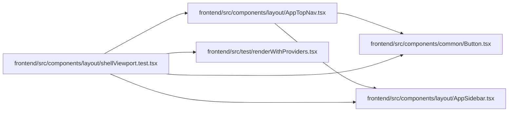

# shellViewport.test Module

**Path:** `frontend/src/components/layout/shellViewport.test.tsx`

## Description

_Auto-generated from `frontend/src/components/layout/shellViewport.test.tsx`._

## Imports

| Source | Symbols | Type-only | Runtime emission |
|--------|---------|-----------|------------------|
| `../../test/renderWithProviders` | `renderWithProviders` | — | compiler-dependent |
| `../common/Button` | `Button` | — | compiler-dependent |
| `./AppSidebar` | `AppSidebar` | — | compiler-dependent |
| `./AppTopNav` | `AppTopNav` | — | compiler-dependent |
| `@testing-library/react` | `screen`, `waitFor`, `within` | — | compiler-dependent |
| `node:fs` | `readFileSync` | — | compiler-dependent |
| `node:path` | `resolve` | — | compiler-dependent |
| `vitest` | `afterEach`, `beforeEach`, `describe`, `expect`, `it`, `vi` | — | compiler-dependent |

## Module Signals

| Signal | Values |
|--------|--------|
| Constants | `planningSummaryMock`, `scopeServiceMocks`, `css` |
| Module calls | `planningSummaryMock = hoisted`, `scopeServiceMocks = hoisted`, `mock`, `mock`, `mock`, `mock`, `mock`, `mock`, `css = readFileSync`, `describe` |

## Local dependency map

<!-- Auto-generated local dependency summary. Do not edit by hand. -->

### Internal neighbors

| Direction | Module |
|---|---|
| Outbound | [Button](../modules/Button.md) |
| Outbound | [AppSidebar](../modules/AppSidebar.md) |
| Outbound | [AppTopNav](../modules/AppTopNav.md) |
| Outbound | [renderWithProviders](../modules/renderWithProviders.md) |

### External packages

| Language | Used packages | Undeclared packages |
|---|---:|---:|
| typescript | 2 | 0 |

## Classes

| Class | Kind | Line | Bases / Target | Description |
|-------|------|------|----------------|-------------|
| [Viewport](../entities/Viewport.md) | Type alias | 32 | `{ width: number; height: number }` | — |
