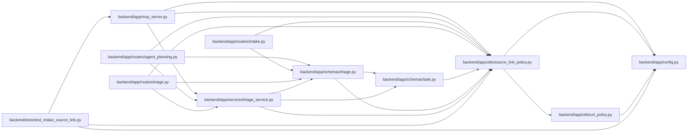

# source_link_policy Module

**Path:** `backend/app/utils/source_link_policy.py`

## Description

One policy for the source link carried by intakes and tasks.

A source link is shown to people and never fetched by the server, so it may be:

* an absolute public ``http(s)`` URL, kept as written;
* a path inside this WorkChord instance (``/tasks?project=6``), kept as written;
* an absolute URL that points at this same instance, which is rewritten to its
  relative path so it keeps working wherever the instance is opened.

Anything else (private, link-local or reserved addresses, other schemes, embedded
credentials) is refused. "This same instance" means a loopback host (``localhost``,
``*.localhost``, ``127.0.0.0/8``, ``::1``, on any port) or the host and port of the
configured ``PUBLIC_BASE_URL``.

## Imports

| Source | Symbols |
|--------|---------|
| `__future__` | `annotations` |
| `app.config` | `get_settings` |
| `app.utils.url_policy` | `URLPolicyError`, `normalize_stored_display_url` |
| `dataclasses` | `dataclass` |
| `ipaddress` | `ipaddress` |
| `typing` | `Literal`, `Optional` |
| `urllib.parse` | `urlparse` |

## Local dependency map

<!-- Auto-generated local dependency summary. Do not edit by hand. -->

### Internal neighbors

| Direction | Module |
|---|---|
| Inbound | [mcp_server](../modules/mcp_server.md) |
| Inbound | [routers_agent_planning](../modules/routers_agent_planning.md) |
| Inbound | [routers_intake](../modules/routers_intake.md) |
| Inbound | [routers_triage](../modules/routers_triage.md) |
| Inbound | [schemas_task](../modules/schemas_task.md) |
| Inbound | [schemas_triage](../modules/schemas_triage.md) |
| Inbound | [triage_service](../modules/triage_service.md) |
| Inbound | [test_intake_source_link](../modules/test_intake_source_link.md) |
| Outbound | [config](../modules/config.md) |
| Outbound | [url_policy](../modules/url_policy.md) |

## Classes

| Class | Kind | Line | Bases / Target | Description |
|-------|------|------|----------------|-------------|
| [SourceLinkAction](../entities/SourceLinkAction.md) | Type alias | 32 | `Literal['none', 'kept', 'rewritten', 'dropped']` | — |
| [SourceLinkRefused](../entities/SourceLinkRefused.md) | Class | 35 | `ValueError` | Raised when a source link breaks the policy; carries a stable, named error. |
| [SourceLinkDecision](../entities/SourceLinkDecision.md) | Class | 55 | — | What the policy does with one source link. |

## Functions

| Function | Signature | Decorators | Description |
|----------|-----------|------------|-------------|
| `_default_port` | `(scheme: str) -> int \| None` | — | — |
| `_instance_authorities` | `() -> set[tuple[str, int \| None]]` | — | — |
| `_is_loopback_host` | `(host: str) -> bool` | — | — |
| `_is_instance_path` | `(value: str) -> bool` | — | — |
| `evaluate_source_link` | `(raw: Optional[str]) -> SourceLinkDecision` | — | Decide what happens to a source link without raising. |
| `normalize_source_link` | `(raw: Optional[str]) -> Optional[str]` | — | Return the link to store, or raise ``SourceLinkRefused``. |
