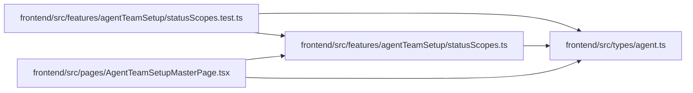

# statusScopes Module

**Path:** `frontend/src/features/agentTeamSetup/statusScopes.ts`

## Description

_Auto-generated from `frontend/src/features/agentTeamSetup/statusScopes.ts`._

## Imports

| Source | Symbols | Type-only | Runtime emission |
|--------|---------|-----------|------------------|
| `../../types/agent` | `AgentTeamStatus` | Declaration | erased |

## Module Signals

| Signal | Values |
|--------|--------|
| Exports | `AgentTeamStatusScopes`, `RuntimeReadinessState`, `SessionAuthorityState`, `TopologyConfigurationState`, `deriveAgentTeamStatusScopes` |

## Local dependency map

<!-- Auto-generated local dependency summary. Do not edit by hand. -->
This graph shows full source coupling. Type dependencies can be erased; compiler-dependent cycle groups are runtime candidates, not confirmed initialization cycles.

### Internal neighbors

| Direction | Module |
|---|---|
| Inbound | [statusScopes.test](../modules/statusScopes.test.md) |
| Inbound | [AgentTeamSetupMasterPage](../modules/AgentTeamSetupMasterPage.md) |
| Outbound | [types_agent](../modules/types_agent.md) |

## Classes

| Class | Kind | Line | Bases / Target | Description |
|-------|------|------|----------------|-------------|
| [AgentTeamStatusScopes](../entities/AgentTeamStatusScopes.md) | Interface | 23 | — | — |
| [TopologyConfigurationState](../entities/TopologyConfigurationState.md) | Type alias | 3 | <pre><code>&#124; &#39;unavailable&#39;&#10;    &#124; &#39;notConfigured&#39;&#10;    &#124; &#39;reconciliationNeeded&#39;&#10;    &#124; &#39;configured&#39;&#10;    &#124; &#39;disabled&#39;</code></pre> | — |
| [SessionAuthorityState](../entities/SessionAuthorityState.md) | Type alias | 10 | <pre><code>&#124; &#39;checking&#39;&#10;    &#124; &#39;unverified&#39;&#10;    &#124; &#39;readOnly&#39;&#10;    &#124; &#39;changesAllowed&#39;</code></pre> | — |
| [RuntimeReadinessState](../entities/RuntimeReadinessState.md) | Type alias | 16 | <pre><code>&#124; &#39;unknown&#39;&#10;    &#124; &#39;blocked&#39;&#10;    &#124; &#39;onboarding&#39;&#10;    &#124; &#39;ready&#39;&#10;    &#124; &#39;disabled&#39;</code></pre> | — |

## Functions

| Function | Signature | Decorators | Description |
|----------|-----------|------------|-------------|
| `deriveAgentTeamStatusScopes` | <pre><code>&#40;&#123;&#10;    status&#44;&#10;    isLoading&#44;&#10;&#125;&#58; &#123;&#10;    status&#58; AgentTeamStatus &#124; undefined&#59;&#10;    isLoading&#58; boolean&#59;&#10;&#125;&#41; &#45;&#62; AgentTeamStatusScopes</code></pre> | — | — |
