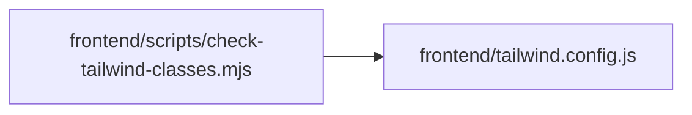

# tailwind.config Module

**Path:** `frontend/tailwind.config.js`

## Description

_Auto-generated from `frontend/tailwind.config.js`._

## Module Signals

| Signal | Values |
|--------|--------|
| Exports | `default` |

## Local dependency map

<!-- Auto-generated local dependency summary. Do not edit by hand. -->

### Internal neighbors

| Direction | Module |
|---|---|
| Inbound | [check-tailwind-classes](../modules/check-tailwind-classes.md) |
