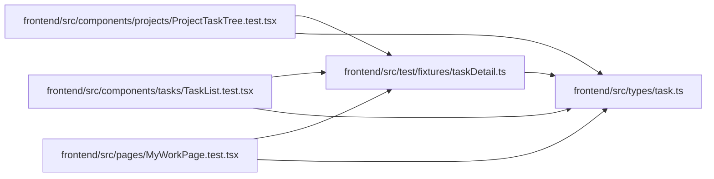

# taskDetail Module

**Path:** `frontend/src/test/fixtures/taskDetail.ts`

## Description

_Auto-generated from `frontend/src/test/fixtures/taskDetail.ts`._

## Imports

| Source | Symbols | Type-only | Runtime emission |
|--------|---------|-----------|------------------|
| `../../types/task` | `Task`, `TaskDetail` | Declaration | erased |

## Module Signals

| Signal | Values |
|--------|--------|
| Exports | `taskDetailResponse` |
| Constants | `emptyPage` |

## Local dependency map

<!-- Auto-generated local dependency summary. Do not edit by hand. -->
This graph shows full source coupling. Type dependencies can be erased; compiler-dependent cycle groups are runtime candidates, not confirmed initialization cycles.

### Internal neighbors

| Direction | Module |
|---|---|
| Inbound | [ProjectTaskTree.test](../modules/ProjectTaskTree.test.md) |
| Inbound | [TaskList.test](../modules/TaskList.test.md) |
| Inbound | [MyWorkPage.test](../modules/MyWorkPage.test.md) |
| Outbound | [types_task](../modules/types_task.md) |

## Functions

| Function | Signature | Decorators | Description |
|----------|-----------|------------|-------------|
| `taskDetailResponse` | `(task: Partial<Task> & { id: number }, reviewerName: string \| null) -> TaskDetail` | — | A `GET /tasks/{id}/detail` response as the backend sends it: the task, its bounded context |
