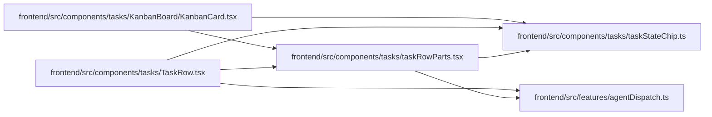

# taskRowParts Module

**Path:** `frontend/src/components/tasks/taskRowParts.tsx`

## Description

_Auto-generated from `frontend/src/components/tasks/taskRowParts.tsx`._

## Imports

| Source | Symbols | Type-only | Runtime emission |
|--------|---------|-----------|------------------|
| `../../features/agentDispatch` | `AgentDispatchState` | Declaration | erased |
| `../../features/agentDispatch` | `AGENT_DISPATCH_LABEL_KEY` | — | compiler-dependent |
| `./taskStateChip` | `TaskStateChip` | Declaration | erased |
| `clsx` | `clsx` | — | compiler-dependent |
| `lucide-react` | `Bot`, `User` | — | compiler-dependent |
| `react-i18next` | `useTranslation` | — | compiler-dependent |

## Module Signals

| Signal | Values |
|--------|--------|
| Exports | `AgentDispatchLine`, `AssigneeKindIcon`, `EffortValue`, `TaskStateChipBadge` |
| Constants | `chipClassName`, `chipLabelKey` |

## Local dependency map

<!-- Auto-generated local dependency summary. Do not edit by hand. -->
This graph shows full source coupling. Type dependencies can be erased; compiler-dependent cycle groups are runtime candidates, not confirmed initialization cycles.

### Internal neighbors

| Direction | Module |
|---|---|
| Inbound | [KanbanCard](../modules/KanbanCard.md) |
| Inbound | [TaskRow](../modules/TaskRow.md) |
| Outbound | [taskStateChip](../modules/taskStateChip.md) |
| Outbound | [agentDispatch](../modules/agentDispatch.md) |

### External packages

| Language | Used packages | Undeclared packages |
|---|---:|---:|
| typescript | 3 | 0 |

## Functions

| Function | Signature | Decorators | Description |
|----------|-----------|------------|-------------|
| `TaskStateChipBadge` | `({ chip, className }: { chip: TaskStateChip; className?: string })` | — | The one state chip of a task; `className` adds visibility rules such as hiding it on narrow rows. |
| `AssigneeKindIcon` | `({ kind, className }: { kind?: 'human' \| 'agent' \| 'hybrid'; className?: string })` | — | A person or an agent, told apart by icon. |
| `AgentDispatchLine` | `({ dispatch, className }: { dispatch: AgentDispatchState; className?: string })` | — | The agent status line under an agent's name. |
| `EffortValue` | `({ effort, className }: { effort: number \| null; className?: string })` | — | Days of effort; `null` shows an unknown estimate as a dash that a screen reader names. |
