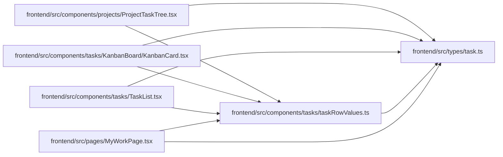

# taskRowValues Module

**Path:** `frontend/src/components/tasks/taskRowValues.ts`

## Description

_Auto-generated from `frontend/src/components/tasks/taskRowValues.ts`._

## Imports

| Source | Symbols | Type-only | Runtime emission |
|--------|---------|-----------|------------------|
| `../../types/task` | `Task` | Declaration | erased |

## Module Signals

| Signal | Values |
|--------|--------|
| Exports | `getEffectiveEffort` |

## Local dependency map

<!-- Auto-generated local dependency summary. Do not edit by hand. -->
This graph shows full source coupling. Type dependencies can be erased; compiler-dependent cycle groups are runtime candidates, not confirmed initialization cycles.

### Internal neighbors

| Direction | Module |
|---|---|
| Inbound | [ProjectTaskTree](../modules/ProjectTaskTree.md) |
| Inbound | [KanbanCard](../modules/KanbanCard.md) |
| Inbound | [TaskList](../modules/TaskList.md) |
| Inbound | [MyWorkPage](../modules/MyWorkPage.md) |
| Outbound | [types_task](../modules/types_task.md) |

## Functions

| Function | Signature | Decorators | Description |
|----------|-----------|------------|-------------|
| `getEffectiveEffort` | `(task: Task) -> number \| null` | — | The effort a row shows: a parent adds up its children, and one unknown child makes the total unknown. |
