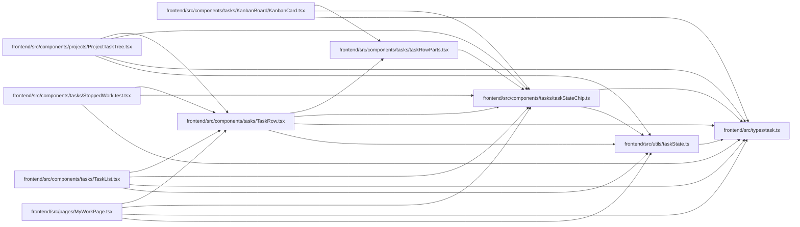

# taskStateChip Module

**Path:** `frontend/src/components/tasks/taskStateChip.ts`

## Description

_Auto-generated from `frontend/src/components/tasks/taskStateChip.ts`._

## Imports

| Source | Symbols | Type-only | Runtime emission |
|--------|---------|-----------|------------------|
| `../../types/task` | `Task`, `TaskStatus` | Declaration | erased |
| `../../utils/taskState` | `isStoppedState`, `stateOf` | — | compiler-dependent |

## Module Signals

| Signal | Values |
|--------|--------|
| Exports | `TaskStateChip`, `isDone`, `taskStateChip` |

## Local dependency map

<!-- Auto-generated local dependency summary. Do not edit by hand. -->
This graph shows full source coupling. Type dependencies can be erased; compiler-dependent cycle groups are runtime candidates, not confirmed initialization cycles.

### Internal neighbors

| Direction | Module |
|---|---|
| Inbound | [ProjectTaskTree](../modules/ProjectTaskTree.md) |
| Inbound | [KanbanCard](../modules/KanbanCard.md) |
| Inbound | [StoppedWork.test](../modules/StoppedWork.test.md) |
| Inbound | [TaskList](../modules/TaskList.md) |
| Inbound | [TaskRow](../modules/TaskRow.md) |
| Inbound | [taskRowParts](../modules/taskRowParts.md) |
| Inbound | [MyWorkPage](../modules/MyWorkPage.md) |
| Outbound | [types_task](../modules/types_task.md) |
| Outbound | [taskState](../modules/taskState.md) |

## Classes

| Class | Kind | Line | Bases / Target | Description |
|-------|------|------|----------------|-------------|
| [TaskStateChip](../entities/TaskStateChip.md) | Type alias | 5 | <pre><code>&#124; &#123; kind&#58; &#39;blocked&#39; &#125;&#10;    &#124; &#123; kind&#58; &#39;needsDefinition&#39; &#125;&#10;    &#124; &#123; kind&#58; &#39;waits&#39;&#59; count&#58; number &#125;&#10;    &#124; &#123; kind&#58; &#39;ready&#39; &#125;&#10;    &#124; &#123; kind&#58; &#39;inReview&#39; &#125;</code></pre> | The one state a row names, chosen by priority: Blocked, Needs definition, Waits for n, Ready to start, In review. |

## Functions

| Function | Signature | Decorators | Description |
|----------|-----------|------------|-------------|
| `isDone` | `(status: TaskStatus \| undefined)` | — | — |
| `taskStateChip` | `(task: Task, taskMap?: Map<number, Task>) -> TaskStateChip \| null` | — | Chooses the single state chip for a task; `taskMap` lets Waits count only the dependencies still open. |
