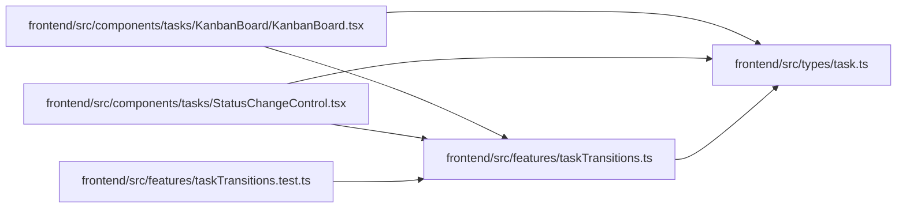

# taskTransitions Module

**Path:** `frontend/src/features/taskTransitions.ts`

## Description

_Auto-generated from `frontend/src/features/taskTransitions.ts`._

## Imports

| Source | Symbols | Type-only | Runtime emission |
|--------|---------|-----------|------------------|
| `../types/task` | `TaskStatus` | Declaration | erased |

## Module Signals

| Signal | Values |
|--------|--------|
| Exports | `TASK_TRANSITIONS`, `canTransition` |
| Constants | `TASK_TRANSITIONS` |

## Local dependency map

<!-- Auto-generated local dependency summary. Do not edit by hand. -->
This graph shows full source coupling. Type dependencies can be erased; compiler-dependent cycle groups are runtime candidates, not confirmed initialization cycles.

### Internal neighbors

| Direction | Module |
|---|---|
| Inbound | [KanbanBoard](../modules/KanbanBoard.md) |
| Inbound | [StatusChangeControl](../modules/StatusChangeControl.md) |
| Inbound | [taskTransitions.test](../modules/taskTransitions.test.md) |
| Outbound | [types_task](../modules/types_task.md) |

## Functions

| Function | Signature | Decorators | Description |
|----------|-----------|------------|-------------|
| `canTransition` | `(from: TaskStatus, to: TaskStatus)` | — | — |
