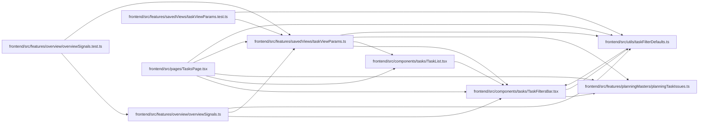

# taskViewParams Module

**Path:** `frontend/src/features/savedViews/taskViewParams.ts`

## Description

_Auto-generated from `frontend/src/features/savedViews/taskViewParams.ts`._

## Imports

| Source | Symbols | Type-only | Runtime emission |
|--------|---------|-----------|------------------|
| `../../components/tasks/TaskFiltersBar` | `TaskFilters` | Declaration | erased |
| `../../components/tasks/TaskList` | `SortKey` | Declaration | erased |
| `../../utils/taskFilterDefaults` | `defaultFilters` | — | compiler-dependent |
| `../planningMasters/planningTaskIssues` | `PLANNING_TASK_ISSUE_PARAM`, `parsePlanningTaskIssue` | — | compiler-dependent |

## Module Signals

| Signal | Values |
|--------|--------|
| Exports | `TASK_CLEARED_VIEW_PARAM`, `TASK_CLEARED_VIEW_VALUE`, `TASK_FILTER_PARAMS`, `TASK_GROUP_PARAM`, `TASK_SORT_PARAM`, `activeFilterCount`, `filtersFromSearchParams`, `groupByStatusFromSearchParams`, `searchParamsNameView`, `sortKeyFromSearchParams`, `writeClearedViewMarker`, `writeFiltersToSearchParams`, `writeSortKeyToSearchParams` |
| Constants | `TASK_FILTER_PARAMS`, `TASK_SORT_PARAM`, `TASK_GROUP_PARAM`, `TASK_CLEARED_VIEW_PARAM`, `TASK_CLEARED_VIEW_VALUE`, `TASK_STATUSES`, `DATE_PATTERN`, `UNASSIGNED_VALUE`, `SORT_PARAM_VALUES` |

## Local dependency map

<!-- Auto-generated local dependency summary. Do not edit by hand. -->
This graph shows full source coupling. Type dependencies can be erased; compiler-dependent cycle groups are runtime candidates, not confirmed initialization cycles.

### Internal neighbors

| Direction | Module |
|---|---|
| Inbound | [overviewSignals.test](../modules/overviewSignals.test.md) |
| Inbound | [overviewSignals](../modules/overviewSignals.md) |
| Inbound | [taskViewParams.test](../modules/taskViewParams.test.md) |
| Inbound | [TasksPage](../modules/TasksPage.md) |
| Outbound | [TaskFiltersBar](../modules/TaskFiltersBar.md) |
| Outbound | [TaskList](../modules/TaskList.md) |
| Outbound | [planningTaskIssues](../modules/planningTaskIssues.md) |
| Outbound | [taskFilterDefaults](../modules/taskFilterDefaults.md) |

## Functions

| Function | Signature | Decorators | Description |
|----------|-----------|------------|-------------|
| `filtersFromSearchParams` | `(params: URLSearchParams) -> TaskFilters` | — | — |
| `writeFiltersToSearchParams` | `(params: URLSearchParams, filters: TaskFilters)` | — | Writes every filter into `params`, removing the ones that are off. |
| `searchParamsNameView` | `(params: URLSearchParams)` | — | True when the URL names any filter or a sort, or says they were all removed, so it carries a view of its own. |
| `writeClearedViewMarker` | `(params: URLSearchParams, viewShown: boolean)` | — | After a change to the filters or order: while a saved view is shown and the URL names no filter and no order, |
| `sortKeyFromSearchParams` | `(params: URLSearchParams) -> SortKey` | — | — |
| `writeSortKeyToSearchParams` | `(params: URLSearchParams, sortKey: SortKey)` | — | — |
| `groupByStatusFromSearchParams` | `(params: URLSearchParams)` | — | — |
| `activeFilterCount` | `(filters: TaskFilters)` | — | Number of active conditions, one per chip. |
