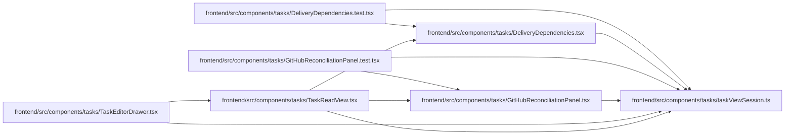

# taskViewSession Module

**Path:** `frontend/src/components/tasks/taskViewSession.ts`

## Description

Memory-only state of the task view's panels (prerequisite list open, branch conflict notice shown, catch-up finished), held for as long as the drawer is open and scoped to the signed-in person and task. The task view remounts on every task version change, so the panels read and update this state instead of keeping their own.

## Imports

| Source | Symbols | Type-only | Runtime emission |
|--------|---------|-----------|------------------|
| `react` | `useCallback`, `useState` | — | compiler-dependent |

## Module Signals

| Signal | Values |
|--------|--------|
| Exports | `EMPTY_TASK_VIEW_SESSION`, `TaskViewSession`, `TaskViewSessionUpdate`, `useTaskViewSession` |
| Constants | `EMPTY_TASK_VIEW_SESSION` |

## Local dependency map

<!-- Auto-generated local dependency summary. Do not edit by hand. -->
This graph shows full source coupling. Type dependencies can be erased; compiler-dependent cycle groups are runtime candidates, not confirmed initialization cycles.

### Internal neighbors

| Direction | Module |
|---|---|
| Inbound | [DeliveryDependencies.test](../modules/DeliveryDependencies.test.md) |
| Inbound | [DeliveryDependencies](../modules/DeliveryDependencies.md) |
| Inbound | [GitHubReconciliationPanel.test](../modules/GitHubReconciliationPanel.test.md) |
| Inbound | [GitHubReconciliationPanel](../modules/GitHubReconciliationPanel.md) |
| Inbound | [TaskEditorDrawer](../modules/TaskEditorDrawer.md) |
| Inbound | [TaskReadView](../modules/TaskReadView.md) |

### External packages

| Language | Used packages | Undeclared packages |
|---|---:|---:|
| typescript | 1 | 0 |

## Classes

| Class | Kind | Line | Bases / Target | Description |
|-------|------|------|----------------|-------------|
| [TaskViewSession](../entities/TaskViewSession.md) | Interface | 7 | — | What a person was doing in the task view's panels. The view remounts whenever the task version |
| [TaskViewSessionUpdate](../entities/TaskViewSessionUpdate.md) | Type alias | 8 | `(patch: Partial<TaskViewSession>) => void` | — |

## Functions

| Function | Signature | Decorators | Description |
|----------|-----------|------------|-------------|
| `useTaskViewSession` | `(scope: string \| null)` | — | Session state keyed by the signed-in person and task, so it never carries to another person or task. |
