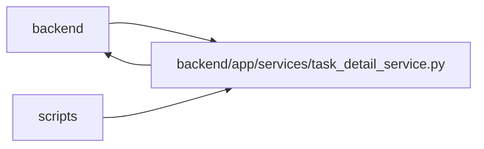

# task_detail_service Module

**Path:** `backend/app/services/task_detail_service.py`

## Description

Reference lookup supports bounded ascending-ID reads, status/search/scope filters and root or direct-child expansion. Parent visibility and scope are checked before child paging. Existing live-read behavior requires refresh for changes behind a cursor; no projection replaces the complete execution graph.

Provides bounded task references, title/ID lookup and human ownership queues without loading the full execution graph. Human work can be filtered by authorized project, iteration or backlog before pagination. Queue categorization remains server-owned, including blocked prerequisites and acceptance reconciliation. Reference projections do not establish complete execution context.

UI detail computes inherited flags through a bounded parent-policy projection, authorizing every parent scope before serialization. It does not hydrate execution children/dependencies. Displayed ancestors remain separately bounded; unavailable roots fail closed, and a changed task version during the read requires reloading initial context.
Detail and the In review queue items carry `reviewer_name`, the display name of the agent holding the task's live verification assignment, read in one bounded query per page; it is empty when any authorized person may review.

Human ownership queues apply complete inherited deferral policy to every bounded candidate and exclude deferred descendants from ordinary work queues. Pagination retains the underlying candidate cursor and has-more indication even when eligibility filtering empties a page, so later eligible work remains discoverable without an unbounded fill scan. Policy ancestry and authorization failures remain explicit.

## Imports

| Source | Symbols |
|--------|---------|
| `app.authority` | `require_project`, `internal_authority`, `require_project` |
| `app.commands` | `PlanningConflict` |
| `app.models.agent` | `AgentActor`, `AgentTaskAssignment` |
| `app.models.iteration` | `Iteration` |
| `app.models.project` | `Project` |
| `app.models.task` | `Task`, `TaskDependency` |
| `app.query_limits` | `MAX_ITERATION_TREE_TASKS` |
| `app.schemas.task` | `TaskAgentReadiness` |
| `app.schemas.task_detail` | `TaskDetailResponse`, `TaskReference`, `TaskReferencePage` |
| `app.services.delivery_dependency_service` | `DeliveryDependencyService` |
| `app.services.task_domain_service` | `TaskDomainService` |
| `app.services.task_service` | `TaskService` |
| `app.sql_semantics` | `portable_contains` |
| `sqlalchemy` | `and_`, `literal`, `or_`, `select` |
| `sqlalchemy.orm` | `selectinload`, `raiseload` |

## Local dependency map

<!-- Auto-generated local dependency summary. Do not edit by hand. -->

> Module-level dependencies exceed the generated-diagram limits, so the diagram and table below group them by top-level package. Counts report the number of module neighbors in each package.

### Internal neighbors

| Direction | Module |
|---|---|
| Inbound | `backend` (6) |
| Inbound | `scripts` (1) |
| Outbound | `backend` (13) |

### External packages

| Language | Used packages | Undeclared packages |
|---|---:|---:|
| python | 1 | 0 |

> All 20 module neighbor(s) are summarized by package because the module-level view exceeds the 12-node limit.

## Classes

| Class | Line | Bases | Description |
|-------|------|-------|-------------|
| [TaskDetailService](../entities/TaskDetailService.md) | 12 | — | — |