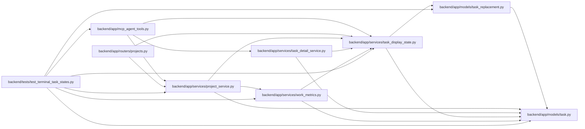

# task_display_state Module

**Path:** `backend/app/services/task_display_state.py`

## Description

The state a task is shown in: its stored status, or the terminal state of withdrawn work.

Canceled work keeps the status it had when it was canceled (the stored column never changes), so any
count or filter that read that status would show it as planned, active or resolved. The displayed
state is derived instead, from ``canceled_at`` and the replacement records:

- ``canceled``: canceled work with no task delivering it instead.
- ``superseded``: canceled work whose deliverable another task carries. A clean replacement is
  labelled superseded too, with the replacement as its successor; ``successor_kind`` tells the two
  dispositions apart (``replacement`` or ``supersession``).

Postponed stays a stored status of its own.

## Imports

| Source | Symbols |
|--------|---------|
| `app.models.task` | `TaskStatus`, `Task` |
| `app.models.task_replacement` | `TaskReplacement` |
| `sqlalchemy` | `and_`, `case`, `exists`, `select` |

## Local dependency map

<!-- Auto-generated local dependency summary. Do not edit by hand. -->

### Internal neighbors

| Direction | Module |
|---|---|
| Inbound | [mcp_agent_tools](../modules/mcp_agent_tools.md) |
| Inbound | [projects](../modules/projects.md) |
| Inbound | [project_service](../modules/project_service.md) |
| Inbound | [task_detail_service](../modules/task_detail_service.md) |
| Inbound | [services_work_metrics](../modules/services_work_metrics.md) |
| Inbound | [test_terminal_task_states](../modules/test_terminal_task_states.md) |
| Outbound | [models_task](../modules/models_task.md) |
| Outbound | [models_task_replacement](../modules/models_task_replacement.md) |

### External packages

| Language | Used packages | Undeclared packages |
|---|---:|---:|
| python | 1 | 0 |

## Functions

| Function | Signature | Decorators | Description |
|----------|-----------|------------|-------------|
| `validate_state_filter` | `(state)` | — | A displayed state a task list can be filtered by. |
| `withdrawn_by_successor` | `(id_column)` | — | SQL: a replacement record names another task as delivering this one's work. |
| `state_clause` | `(state, *, id_column, status_column, canceled_at_column)` | — | SQL predicate: the task is shown in this displayed state. |
| `displayed_state_expression` | `(*, id_column, status_column, canceled_at_column)` | — | SQL expression of the displayed state, for lists that show it beside the stored status. |
| `task_state_clause` | `(state)` | — | The state predicate for a query over the Task entity. |
