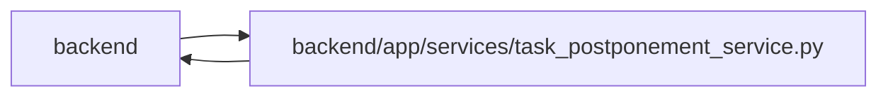

# task_postponement_service Module

**Path:** `backend/app/services/task_postponement_service.py`

## Description

Postpone task work with a recorded reason and requirements, and reactivate it.

Postponing stops planned, active or resolved leaf work without canceling it.
Live execution is released through the same fenced path as cancellation, and
the brief, progress, evidence, artifact trail and execution provenance stay as
they were. The postponement records why, who decided and what must be true
before the work resumes. Reactivation returns resolved work to resolved and
planned or active work to planned. Only the project's PM actor, a project
manager or a workspace operator may postpone or reactivate.

Deferral (``is_deferred``) is a different thing: a scheduling policy that keeps
backlog work out of the schedule and from starting. It never stops work that has
started and records no requirements.

## Imports

| Source | Symbols |
|--------|---------|
| `app.authority` | `AuthorityError`, `internal_authority`, `require_project` |
| `app.commands` | `PlanningConflict`, `atomic_command` |
| `app.models.calendar` | `Calendar` |
| `app.models.iteration` | `Iteration` |
| `app.models.project` | `Project` |
| `app.models.task` | `Task`, `TaskStatus` |
| `app.models.task_postponement` | `POSTPONABLE_STATUSES`, `RESOLVED_TRIAGE_STATUSES`, `TaskPostponement`, `TaskReactivationRequirement` |
| `app.models.triage` | `TriageItem` |
| `app.services.identity_service` | `acting_principal_id`, `acting_principal_id` |
| `app.services.snapshot_service` | `SnapshotService` |
| `app.services.task_domain_service` | `release_execution` |
| `app.services.task_hierarchy_service` | `TaskTreeIntegrityError` |
| `app.services.task_service` | `TaskService` |
| `app.services.work_metrics` | `working_today` |
| `app.utils.time` | `utc_now` |
| `sqlalchemy` | `or_`, `select` |

## Local dependency map

<!-- Auto-generated local dependency summary. Do not edit by hand. -->

> Module-level dependencies exceed the generated-diagram limits, so the diagram and table below group them by top-level package. Counts report the number of module neighbors in each package.

### Internal neighbors

| Direction | Module |
|---|---|
| Inbound | `backend` (7) |
| Outbound | `backend` (15) |

### External packages

| Language | Used packages | Undeclared packages |
|---|---:|---:|
| python | 1 | 0 |

> All 19 module neighbor(s) are summarized by package because the module-level view exceeds the 12-node limit.

## Classes

| Class | Line | Bases | Description |
|-------|------|-------|-------------|
| [TaskPostponementService](../entities/TaskPostponementService.md) | 140 | — | — |

## Functions

| Function | Signature | Decorators | Description |
|----------|-----------|------------|-------------|
| `open_postponement` | *(async)* `(db, task_id, *, lock = False)` | — | The task's open postponement, if any. |
| `latest_postponement` | *(async)* `(db, task_id)` | — | The open postponement, or else the most recent one. |
| `reactivation_status` | `(postponement)` | — | Where reactivation returns the work: resolved stays resolved, all else is planned again. |
| `decider_blockers` | `(task, authority)` | — | Why this caller cannot decide postponement for this task, as action blockers. |
| `postponement_actions` | `(task, authority)` | — | Availability of the postpone and reactivate commands, in the shared action shape. |
| `_require_decider` | `(db, task)` | — | — |
| `require_restore_compatible` | *(async)* `(db, rows, current)` | — | Refuse a snapshot restore that would move a task into or out of postponed. |
| `require_unreferenced` | *(async)* `(db, *, task_ids = (), triage_item_ids = ())` | — | Refuse deleting work that an open postponement waits for. |
| `_requirement_response` | `(row)` | — | — |
