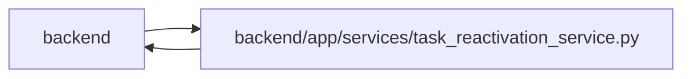

# task_reactivation_service Module

**Path:** `backend/app/services/task_reactivation_service.py`

## Description

Return postponed work to its lifecycle once every recorded requirement holds.

A postponement records requirements of four kinds: named work accepted, a day in
the task's working time zone, an owner decision, and linked work or a triage item
resolved. Nothing here is a person's command except the owner decision. The other
kinds are evaluated against current facts whenever those facts can have changed:
when a task is resolved or accepted, when a triage item is resolved, when the
owner records a decision, and on the daily date check, which also sweeps any
postponement an earlier evaluation could not finish.

Every evaluation first takes the shared planning lock, as every planning command
does, and then the postponement's own row. Two triggers arriving together are
therefore serialized: the second sees what the first committed, and a postponement
whose last requirement the second completes is reactivated exactly once.

A requirement stays met once it has been met; ``met_at`` records when. The task
returns to planned, or to resolved when it was postponed after resolution, and its
timeline names the requirement that completed it.

## Imports

| Source | Symbols |
|--------|---------|
| `app.authority` | `AuthorityError`, `internal_authority`, `require_project` |
| `app.commands` | `PlanningConflict`, `atomic_command`, `current_command`, `lock_planning` |
| `app.config` | `get_settings` |
| `app.database` | `async_session_maker` |
| `app.maintenance` | `require_background_writes_enabled` |
| `app.models.task` | `Task`, `TaskStatus` |
| `app.models.task_postponement` | `RESOLVED_TRIAGE_STATUSES`, `TaskPostponement`, `TaskReactivationRequirement` |
| `app.models.triage` | `TriageItem` |
| `app.services.outbound_webhook_service` | `emit_outbound_webhook_event` |
| `app.services.task_hierarchy_service` | `TaskTreeIntegrityError` |
| `app.services.task_postponement_service` | `POSTPONED`, `TaskPostponementService`, `is_accepted`, `open_postponement`, `latest_postponement` |
| `app.services.work_metrics` | `working_today` |
| `app.utils.time` | `utc_now` |
| `asyncio` | `asyncio` |
| `copy` | `copy` |
| `dataclasses` | `dataclasses` |
| `datetime` | `datetime` |
| `logging` | `logging` |
| `sqlalchemy` | `or_`, `select` |

## Local dependency map

<!-- Auto-generated local dependency summary. Do not edit by hand. -->

> Module-level dependencies exceed the generated-diagram limits, so the diagram and table below group them by top-level package. Counts report the number of module neighbors in each package.

### Internal neighbors

| Direction | Module |
|---|---|
| Inbound | `backend` (7) |
| Outbound | `backend` (13) |

### External packages

| Language | Used packages | Undeclared packages |
|---|---:|---:|
| python | 1 | 0 |

> All 18 module neighbor(s) are summarized by package because the module-level view exceeds the 12-node limit.

## Classes

| Class | Line | Bases | Description |
|-------|------|-------|-------------|
| [ReactivationService](../entities/ReactivationService.md) | 104 | — | — |

## Functions

| Function | Signature | Decorators | Description |
|----------|-----------|------------|-------------|
| `request_reactivation_check` | `(db, *, task_id = None, triage_item_id = None)` | — | Note that work postponed tasks may wait for has changed. |
| `process_reactivation_checks` | *(async)* `(db)` | — | Evaluate the postponements that wait for the noted work; called by the command boundary. |
| `require_owner_decision` | `(db)` | — | Only the workspace owner, or the trusted local owner, can record an owner decision. |
| `_describe` | `(requirement)` | — | — |
| `_summary` | `(requirement)` | — | — |
| `run_due_postponement_checks` | *(async)* `(*, now: datetime \| None = None) -> list[int]` | — | Entry point for the worker: run the daily check in its own session. |
| `postponement_check_loop` | *(async)* `(stop_event, *, interval_seconds = 900.0)` | — | Run the check at a steady interval until shutdown; each run is idempotent. |
