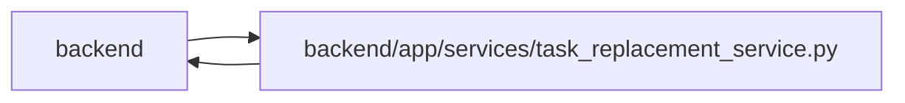

# task_replacement_service Module

**Path:** `backend/app/services/task_replacement_service.py`

## Description

Record and read an audited disposition that names the task delivering another task's work.

A clean replacement: an original task whose runs lack attribution can never pass
independent review. Its work is done again as a separate task from a clean base.
The disposition keeps the original with its attempts, artifacts and unknown
attribution, names who decided and why, moves the original's dependents and
release membership to the replacement, and withdraws the original from delivery
counts. Only the replacement can be accepted, and a replacement that carries
commits from an unattributed run stays held.

A supersession: the original's deliverable was already closed or accepted as
another task before anyone recorded a replacement. The successor is not
re-executed or reopened, and the original is not reopened: it is withdrawn from
delivery counts with its history kept, and its dependents, delivery
prerequisites, release membership and the reactivation requirements that name it
move to the successor, so the deliverable counts once.

## Imports

| Source | Symbols |
|--------|---------|
| `app.authority` | `AuthorityError`, `internal_authority`, `require_project` |
| `app.commands` | `PlanningConflict`, `atomic_command`, `lock_backlog_project` |
| `app.models.agent` | `AgentRun`, `AgentTaskAssignment` |
| `app.models.delivery_dependency` | `DeliveryDependency` |
| `app.models.project` | `Project` |
| `app.models.release` | `Release`, `release_tasks` |
| `app.models.task` | `Task`, `TaskDependency` |
| `app.models.task_postponement` | `TaskPostponement`, `TaskReactivationRequirement` |
| `app.models.task_replacement` | `TaskReplacement` |
| `app.query_limits` | `CollectionLimitExceededError`, `MAX_BOUNDED_LIST_ITEMS` |
| `app.services.delivery_dependency_service` | `DeliveryDependencyService` |
| `app.services.identity_service` | `acting_principal_id`, `acting_principal_id`, `acting_principal_id` |
| `app.services.review_provenance` | `review_history`, `MAX_CARRIED_HISTORY_RUNS`, `MAX_CARRIED_REPLACEMENT_DEPTH` |
| `app.services.snapshot_service` | `SnapshotService`, `SnapshotService` |
| `app.services.task_brief_service` | `clear_acceptance` |
| `app.services.task_postponement_service` | `POSTPONED`, `open_postponement`, `reactivation_status` |
| `app.services.task_reactivation_service` | `request_reactivation_check` |
| `app.services.task_service` | `TaskService` |
| `app.utils.github_links` | `GitHubLinkError`, `parse_github_url` |
| `app.utils.time` | `utc_now` |
| `logging` | `logging` |
| `sqlalchemy` | `insert`, `select` |

## Local dependency map

<!-- Auto-generated local dependency summary. Do not edit by hand. -->

> Module-level dependencies exceed the generated-diagram limits, so the diagram and table below group them by top-level package. Counts report the number of module neighbors in each package.

### Internal neighbors

| Direction | Module |
|---|---|
| Inbound | `backend` (13) |
| Outbound | `backend` (20) |

### External packages

| Language | Used packages | Undeclared packages |
|---|---:|---:|
| python | 1 | 0 |

> All 29 module neighbor(s) are summarized by package because the module-level view exceeds the 12-node limit.

## Classes

| Class | Line | Bases | Description |
|-------|------|-------|-------------|
| [TaskReplacementService](../entities/TaskReplacementService.md) | 229 | — | — |

## Functions

| Function | Signature | Decorators | Description |
|----------|-----------|------------|-------------|
| `attributed` | `(row)` | — | A contribution counts as attributed only with a known profile and publisher and no gap. |
| `replaced_by` | *(async)* `(db, task_id)` | — | The disposition that replaced this task, if any. |
| `replacing` | *(async)* `(db, task_id)` | — | The disposition this task delivers as a replacement, if any. |
| `delivering_leaves` | *(async)* `(db, leaves)` | — | The leaves whose acceptance decides a scope's delivery, each deliverable counted once. |
| `relation_for` | *(async)* `(db, task_id)` | — | The disposition to show for this task; a replacement that was itself replaced shows as replaced. |
| `_assignments` | *(async)* `(db, task_id)` | — | — |
| `attempt_history` | *(async)* `(db, task)` | — | Every recorded attempt on this task alone, with its server-held attribution. |
| `_carried_bound_row` | `(original_task_id, reason)` | — | A contributor row that holds the replacement: the carried chain is too long or cyclic to read. |
| `carried_contributors` | *(async)* `(db, task)` | — | Contributor rows for the original runs this replacement carries, read from current records. |
| `require_acceptable` | *(async)* `(db, task, *, accepting)` | — | A replaced original is never reviewed; a replacement carrying unattributed work stays held. |
| `require_restore_compatible` | *(async)* `(db, rows, current)` | — | Refuse a snapshot restore that would undo or bypass a replacement disposition. |
| `_contributor` | `(row)` | — | — |
| `_require_decider` | `(db, project_id)` | — | — |
| `_base_commit` | `(url)` | — | — |
