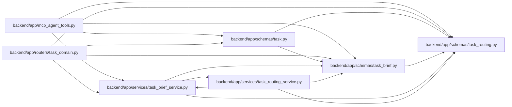

# task_routing Module

**Path:** `backend/app/schemas/task_routing.py`

## Description

Structured routing of one task: its first rung, escalation ladder and reviewer.

The routing lives in the task's canonical brief, so brief revisions keep its history and the
brief text renders from it. Every rung and the reviewer name a model catalog entry by key; the
server fills the entry's effort, publisher and alias when it saves the routing.

## Imports

| Source | Symbols |
|--------|---------|
| `pydantic` | `BaseModel`, `ConfigDict`, `Field`, `field_validator`, `model_validator` |
| `typing` | `Literal` |

## Local dependency map

<!-- Auto-generated local dependency summary. Do not edit by hand. -->

### Internal neighbors

| Direction | Module |
|---|---|
| Inbound | [mcp_agent_tools](../modules/mcp_agent_tools.md) |
| Inbound | [routers_task_domain](../modules/routers_task_domain.md) |
| Inbound | [schemas_task](../modules/schemas_task.md) |
| Inbound | [schemas_task_brief](../modules/schemas_task_brief.md) |
| Inbound | [task_brief_service](../modules/task_brief_service.md) |
| Inbound | [task_routing_service](../modules/task_routing_service.md) |

### External packages

| Language | Used packages | Undeclared packages |
|---|---:|---:|
| python | 1 | 0 |

## Classes

| Class | Kind | Line | Bases / Target | Description |
|-------|------|------|----------------|-------------|
| [RoutingConflictMode](../entities/RoutingConflictMode.md) | Type alias | 12 | `Literal['refuse', 'warn']` | — |
| [RoutingResolution](../entities/RoutingResolution.md) | Type alias | 13 | `Literal['check', 'apply_suggestion']` | — |
| [RoutingRung](../entities/task_routing_RoutingRung.md) | Pydantic model | 16 | `BaseModel` | One model catalog entry that may execute the task. |
| [RoutingReviewer](../entities/task_routing_RoutingReviewer.md) | Pydantic model | 35 | `RoutingRung` | The model that reviews the task's result, and optionally the reviewer profile to dispatch. |
| [TaskRouting](../entities/task_routing_TaskRouting.md) | Pydantic model | 42 | `BaseModel` | First rung, escalation ladder and reviewer of one task. |
| [RoutingIssue](../entities/task_routing_RoutingIssue.md) | Pydantic model | 71 | `BaseModel` | One inconsistency between a task's routing, its assignee and the project policy. |
| [RoutingCheck](../entities/task_routing_RoutingCheck.md) | Pydantic model | 82 | `BaseModel` | Routing consistency of one task for one assignee, with a consistent replacement. |
| [RoutingConvert](../entities/RoutingConvert.md) | Pydantic model | 102 | `BaseModel` | Preview or apply the conversion of free-text routing into structure. |
| [RoutingConvertResponse](../entities/RoutingConvertResponse.md) | Pydantic model | 112 | `BaseModel` | Result of a routing conversion preview or apply. |
