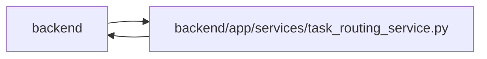

# task_routing_service Module

**Path:** `backend/app/services/task_routing_service.py`

## Description

Keep a task's structured routing consistent with its assignee and the project's review policy.

A task's routing (first rung, escalation ladder, reviewer) is part of its canonical brief. This
module fills catalog facts into a routing, checks it against the assignee's bound models and the
project's different-publisher policy, proposes a consistent replacement, and converts routing
that a brief still carries as free text.

## Imports

| Source | Symbols |
|--------|---------|
| `__future__` | `annotations` |
| `app.commands` | `PlanningConflict`, `current_command`, `current_command` |
| `app.models.agent` | `AgentActor`, `AgentModelBinding`, `AgentModelCatalogEntry`, `AgentTaskAssignment` |
| `app.models.project` | `Project` |
| `app.models.team_member` | `TeamMember`, `TeamMemberProfile` |
| `app.query_limits` | `CollectionLimitExceededError` |
| `app.schemas.task_brief` | `TaskBrief`, `TaskBrief` |
| `app.schemas.task_routing` | `RoutingCheck`, `RoutingConvertResponse`, `RoutingIssue`, `RoutingReviewer`, `RoutingRung`, `TaskRouting` |
| `app.services.agent_routing_service` | `AgentRoutingConflictError` |
| `app.services.review_provenance` | `different_publisher_required`, `review_history` |
| `app.services.task_brief_service` | `TaskBriefService`, `TaskBriefService`, `brief_payload`, `evidence_brief` |
| `dataclasses` | `dataclass`, `field` |
| `re` | `re` |
| `sqlalchemy` | `select` |

## Local dependency map

<!-- Auto-generated local dependency summary. Do not edit by hand. -->

> Module-level dependencies exceed the generated-diagram limits, so the diagram and table below group them by top-level package. Counts report the number of module neighbors in each package.

### Internal neighbors

| Direction | Module |
|---|---|
| Inbound | `backend` (4) |
| Outbound | `backend` (10) |

### External packages

| Language | Used packages | Undeclared packages |
|---|---:|---:|
| python | 1 | 0 |

> All 13 module neighbor(s) are summarized by package because the module-level view exceeds the 12-node limit.

## Classes

| Class | Line | Bases | Description |
|-------|------|-------|-------------|
| [RoutingConsistencyConflict](../entities/RoutingConsistencyConflict.md) | 29 | `PlanningConflict` | A routing change refused under the project's policy; the detail carries a consistent routing. |
| [AssigneeModels](../entities/AssigneeModels.md) | 44 | — | The catalog entries the assignee row's agents can run. |
| [_Facts](../entities/Facts.md) | 163 | — | What a routing is checked against: the assignee, the policy and the live catalog. |
| [_Resolver](../entities/Resolver.md) | 464 | — | Match a model named in prose to exactly one enabled catalog entry by exact key or alias. |

## Functions

| Function | Signature | Decorators | Description |
|----------|-----------|------------|-------------|
| `_rank` | `(entry) -> tuple[int, int]` | — | — |
| `_rung_from` | `(entry, *, harness = '', reviewer = False, **extra)` | — | — |
| `catalog_entries` | *(async)* `(db, keys = None) -> dict[str, AgentModelCatalogEntry]` | — | — |
| `_routing_keys` | `(routing: TaskRouting) -> list[str]` | — | — |
| `resolve_routing` | *(async)* `(db, routing: TaskRouting) -> TaskRouting` | — | Fill each rung and the reviewer from its enabled catalog entry; refuse unknown references. |
| `assignee_models` | *(async)* `(db, assignee_id) -> AssigneeModels` | — | Enabled catalog entries bound to the enabled, active agents of the assignee row's profile. |
| `_verifier_profiles` | *(async)* `(db) -> dict[str, list[int]]` | — | Catalog key -> profiles of enabled agents that hold it and whose profile verifies. |
| `project_policy` | *(async)* `(db, project_id) -> tuple[bool, str]` | — | — |
| `_contributor_publishers` | *(async)* `(db, task) -> tuple[set[str], bool]` | — | Publishers review provenance already counts as contributors of this task, as reviewer selection sees them. |
| `_refreshed` | `(routing: TaskRouting, catalog) -> TaskRouting` | — | The routing with publisher, effort and alias as the catalog states them now. |
| `_available` | `(catalog, rung) -> bool` | — | — |
| `_issues` | `(routing: TaskRouting, facts: _Facts) -> list[RoutingIssue]` | — | — |
| `_choose_first_rung` | `(models: AssigneeModels, current: RoutingRung \| None)` | — | — |
| `suggest_routing` | `(routing: TaskRouting, facts: _Facts) -> tuple[TaskRouting \| None, list[RoutingIssue]]` | — | A routing consistent with the assignee and policy that keeps as much of the current one as it can. |
| `check_routing` | *(async)* `(db, *, task = None, task_id = None, project_id, assignee_id, routing: dict \| TaskRouting \| None, brief_text: str \| None = None, removed_routing: bool = False) -> RoutingCheck` | — | Check one routing against one assignee under the project's policy and offer a consistent one. |
| `routing_check_for` | `(db, task_id) -> RoutingCheck \| None` | — | The routing check this command made for a task, for its response. |
| `_remember` | `(db, task_id, check)` | — | — |
| `enforce_routing` | *(async)* `(db, task, *, resolution: str = 'check', changed: bool, removed_routing: bool = False) -> RoutingCheck \| None` | — | Check the task's routing for its current assignee; apply the suggestion, refuse or warn. |
| `_norm` | `(label: str) -> str` | — | — |
| `_cut` | `(text: str, start: int, end: int, replacement: str = '') -> str` | — | Remove one sentence and close the gap it leaves on its own line only. |
| `_remove_first` | `(text: str, sentence: str) -> str` | — | — |
| `parse_text_routing` | `(brief: dict, entries, existing: dict \| None = None) -> tuple[dict, dict, list[str], list[str]]` | — | Parse routing sentences out of a brief's context and verification. |
| `convert_text_routing` | *(async)* `(db, task, *, override: TaskRouting \| None = None, apply: bool = False) -> RoutingConvertResponse` | — | Preview or apply moving a brief's free-text routing into structure, keeping every replaced sentence. |
