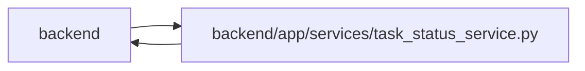

# task_status_service Module

**Path:** `backend/app/services/task_status_service.py`

## Description

Task status transitions, roll-up reconciliation, and status reporting.

Legacy execution transitions recheck the same complete ancestry policy as canonical manual actions. Deferral prevents execution start or resolution while review-authorized rework retains its distinct non-executor attribution. Rejected transitions roll back their aggregate and recovery reservations with the owning command.

Retains planned/active/resolved/closed transitions while separating actual UTC start/resolve/accept events from forecast dates and committed baselines. Acceptance requires review authority and is bound to the current task revision; automatic parent roll-up cannot fabricate independent leaf acceptance.

Direct lifecycle changes retain planned, active, resolved and closed values; summaries derive status from children. Human manual starts preserve forecast dates while recording actual UTC events. Independent acceptance is checked before closure. A review-authorized rejection returns work to active without attributing execution to the reviewer and requires fresh progress for subsequent acceptance.

For scheduled work, the forecast follows what happened: a start moves the task to the actual day and keeps its length, earlier or later, and a submit ends it on the actual day. A later end shifts planned dependents; the server makes that shift itself, so a caller without planning scope can still start late work.

## Imports

| Source | Symbols |
|--------|---------|
| `app.authority` | `AuthorityError`, `require_project`, `internal_authority` |
| `app.commands` | `atomic_command`, `command_transaction`, `commit_or_flush`, `lock_iterations`, `PlanningConflict` |
| `app.models.calendar` | `Calendar` |
| `app.models.iteration` | `Iteration` |
| `app.models.project` | `Project` |
| `app.models.task` | `Task`, `TaskDependency`, `TaskStatus` |
| `app.models.task_status_log` | `TaskStatusLog` |
| `app.query_limits` | `CollectionLimitExceededError`, `MAX_BOUNDED_LIST_ITEMS` |
| `app.services.delivery_dependency_service` | `DeliveryDependencyService` |
| `app.services.language_service` | `automatic_child_status_reason`, `incomplete_dependency_message`, `resolve_runtime_ui_language`, `task_requires_schedule_message` |
| `app.services.outbound_webhook_service` | `OutboundWebhookService` |
| `app.services.scheduler_service` | `rebind_queued_assignments` |
| `app.services.snapshot_service` | `SnapshotService` |
| `app.services.task_brief_service` | `TaskBriefService`, `TaskBriefService` |
| `app.services.task_hierarchy_service` | `TaskTreeIntegrityError` |
| `app.services.task_service` | `TaskService` |
| `app.services.work_metrics` | `effective_work_flags`, `working_today`, `task_signals` |
| `app.utils.time` | `utc_now` |
| `datetime` | `date`, `timedelta` |
| `json` | `json` |
| `sqlalchemy` | `desc`, `func`, `select` |
| `sqlalchemy.ext.asyncio` | `AsyncSession` |
| `sqlalchemy.orm` | `selectinload` |
| `typing` | `Any`, `Optional`, `Sequence`, `TYPE_CHECKING` |

## Local dependency map

<!-- Auto-generated local dependency summary. Do not edit by hand. -->

> Module-level dependencies exceed the generated-diagram limits, so the diagram and table below group them by top-level package. Counts report the number of module neighbors in each package.

### Internal neighbors

| Direction | Module |
|---|---|
| Inbound | `backend` (2) |
| Outbound | `backend` (18) |

### External packages

| Language | Used packages | Undeclared packages |
|---|---:|---:|
| python | 1 | 0 |

> All 19 module neighbor(s) are summarized by package because the module-level view exceeds the 12-node limit.

## Classes

| Class | Line | Bases | Description |
|-------|------|-------|-------------|
| [TaskStatusService](../entities/TaskStatusService.md) | 30 | — | Own status transitions, dependent cascades, and parent reconciliation. |