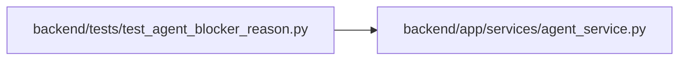

# test_agent_blocker_reason Module

**Path:** `backend/tests/test_agent_blocker_reason.py`

## Description

An agent-reported blocker becomes the task's human-readable Blocked reason.

## Imports

| Source | Symbols |
|--------|---------|
| `__future__` | `annotations` |
| `app.services.agent_service` | `MAX_BLOCKER_REASON_CHARS`, `blocker_reason_from_payload` |
| `pytest` | `pytest` |

## Local dependency map

<!-- Auto-generated local dependency summary. Do not edit by hand. -->

### Internal neighbors

| Direction | Module |
|---|---|
| Outbound | [agent_service](../modules/agent_service.md) |

### External packages

| Language | Used packages | Undeclared packages |
|---|---:|---:|
| python | 1 | 1 |

## Functions

| Function | Signature | Decorators | Description |
|----------|-----------|------------|-------------|
| `test_reason_uses_the_first_meaningful_text_field` | `(payload, expected) -> None` | `@pytest.mark.parametrize(('payload', 'expected'), [({'blocker': '  Database credentials are missing  '}, 'Database credentials are missing'), ({'summary': 'Waiting for API access', 'impact': 'high'}, 'Waiting for API access'), ({'blocker': '', 'reason': 'Upstream service is down'}, 'Upstream service is down'), ({'message': 'Cannot reach the staging host'}, 'Cannot reach the staging host')])` | — |
| `test_reason_falls_back_to_a_neutral_sentence` | `(payload) -> None` | `@pytest.mark.parametrize('payload', [{}, {'blocker': 3}, {'impact': 'high'}, None, ['blocker']])` | — |
| `test_reason_is_bounded` | `() -> None` | — | — |
