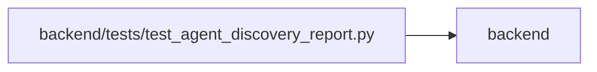

# test_agent_discovery_report Module

**Path:** `backend/tests/test_agent_discovery_report.py`

## Description

A worker with an accepted assignment can report out-of-scope work to triage, and nothing more.

## Imports

| Source | Symbols |
|--------|---------|
| `app.authority` | `AuthorityError` |
| `app.main` | `app` |
| `app.models.agent` | `AgentActor`, `TaskEvent` |
| `app.models.project` | `Project` |
| `app.models.task` | `Task` |
| `app.models.triage` | `TriageItem` |
| `app.services` | `agent_work_service`, `backlog_snapshot_service`, `work_metrics` |
| `app.services.identity_service` | `IdentityService` |
| `app.utils` | `time` |
| `datetime` | `UTC`, `date`, `datetime`, `timedelta` |
| `httpx` | `httpx` |
| `json` | `json` |
| `pytest` | `pytest` |
| `sqlalchemy` | `select` |
| `tests.test_agent_runtime_recovery` | `seed_work` |
| `tests.test_delivery_scenarios` | `delivery_store` |

## Local dependency map

<!-- Auto-generated local dependency summary. Do not edit by hand. -->

> Module-level dependencies exceed the generated-diagram limits, so the diagram and table below group them by top-level package. Counts report the number of module neighbors in each package.

### Internal neighbors

| Direction | Module |
|---|---|
| Outbound | `backend` (13) |

### External packages

| Language | Used packages | Undeclared packages |
|---|---:|---:|
| python | 3 | 1 |

> All 13 module neighbor(s) are summarized by package because the module-level view exceeds the 12-node limit.

## Functions

| Function | Signature | Decorators | Description |
|----------|-----------|------------|-------------|
| `frozen_working_day` | `(monkeypatch)` | `@pytest.fixture` | — |
| `begin_as_worker` | *(async)* `(factory, scenario, today, client, headers)` | — | — |
| `discovery_body` | `(begun, **changes)` | — | — |
| `test_worker_reports_a_discovery_from_its_accepted_assignment` | *(async)* `(delivery_store, frozen_working_day)` | — | — |
| `test_worker_cannot_create_triage_items_any_other_way` | *(async)* `(delivery_store, frozen_working_day)` | — | The discovery command is the only door: the general triage route stays closed to a worker. |
| `test_guard_admits_only_the_discovery_the_command_announced` | *(async)* `(delivery_store, frozen_working_day, case)` | `@pytest.mark.parametrize('case', ['unmarked', 'other_source', 'other_project', 'second_item'])` | — |
