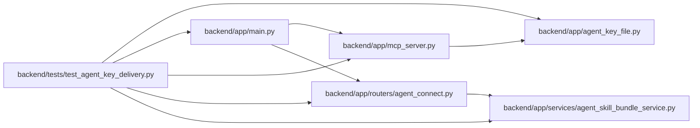

# test_agent_key_delivery Module

**Path:** `backend/tests/test_agent_key_delivery.py`

## Description

An operator can hand an agent its key without chat or an inherited shell.

## Imports

| Source | Symbols |
|--------|---------|
| `__future__` | `annotations` |
| `app` | `mcp_server` |
| `app.agent_key_file` | `AgentKeyFileError`, `read_agent_key_file` |
| `app.main` | `app` |
| `app.routers` | `agent_connect` |
| `app.services.agent_skill_bundle_service` | `AgentSkillBundleService` |
| `httpx` | `httpx` |
| `importlib.util` | `importlib.util` |
| `json` | `json` |
| `os` | `os` |
| `pathlib` | `Path` |
| `pytest` | `pytest` |
| `sys` | `sys` |
| `typing` | `Any` |

## Local dependency map

<!-- Auto-generated local dependency summary. Do not edit by hand. -->

### Internal neighbors

| Direction | Module |
|---|---|
| Outbound | [agent_key_file](../modules/agent_key_file.md) |
| Outbound | [app_main](../modules/app_main.md) |
| Outbound | [mcp_server](../modules/mcp_server.md) |
| Outbound | [routers_agent_connect](../modules/routers_agent_connect.md) |
| Outbound | [agent_skill_bundle_service](../modules/agent_skill_bundle_service.md) |

### External packages

| Language | Used packages | Undeclared packages |
|---|---:|---:|
| python | 2 | 1 |

## Classes

| Class | Line | Bases | Description |
|-------|------|-------|-------------|
| [_ActorResponse](../entities/ActorResponse.md) | 112 | — | — |

## Functions

| Function | Signature | Decorators | Description |
|----------|-----------|------------|-------------|
| `_key_file` | `(tmp_path: Path, content: str, mode: int = 384) -> Path` | — | — |
| `test_key_file_returns_the_single_key_without_surrounding_whitespace` | `(tmp_path: Path) -> None` | — | — |
| `test_key_file_readable_by_others_is_refused_without_revealing_content` | `(tmp_path: Path) -> None` | `@posix_only` | — |
| `test_key_file_must_hold_exactly_one_key` | `(tmp_path: Path, content: str) -> None` | `@pytest.mark.parametrize('content', ['', '\n', 'one\ntwo\n'])` | — |
| `test_missing_key_file_is_named` | `(tmp_path: Path) -> None` | — | — |
| `stdio_key_state` | `(monkeypatch: pytest.MonkeyPatch)` | `@pytest.fixture` | — |
| `test_stdio_mcp_reads_its_key_from_the_configured_file` | `(stdio_key_state: pytest.MonkeyPatch, tmp_path: Path) -> None` | — | — |
| `test_stdio_mcp_key_variable_wins_over_the_key_file` | `(stdio_key_state: pytest.MonkeyPatch, tmp_path: Path) -> None` | — | — |
| `test_stdio_mcp_without_any_key_names_both_sources` | `(stdio_key_state: pytest.MonkeyPatch, capsys: pytest.CaptureFixture[str]) -> None` | — | — |
| `_run_provisioning` | `(monkeypatch: pytest.MonkeyPatch, *args: str) -> None` | — | — |
| `test_provisioning_writes_the_key_to_an_owner_only_file_and_prints_only_its_path` | `(monkeypatch: pytest.MonkeyPatch, tmp_path: Path, capsys: pytest.CaptureFixture[str]) -> None` | `@posix_only` | — |
| `test_provisioning_refuses_an_existing_key_file_before_creating_the_actor` | `(monkeypatch: pytest.MonkeyPatch, tmp_path: Path) -> None` | — | — |
| `test_provisioning_refuses_a_key_file_inside_a_repository` | `(tmp_path: Path) -> None` | — | — |
| `test_connect_hint_is_public_secret_free_and_lists_role_scopes` | *(async)* `(deployed_agent_skill_release: Path) -> None` | `@pytest.mark.asyncio` | — |
| `test_connect_hint_still_answers_when_skill_artifacts_are_missing` | *(async)* `(tmp_path: Path) -> None` | `@pytest.mark.asyncio` | — |
