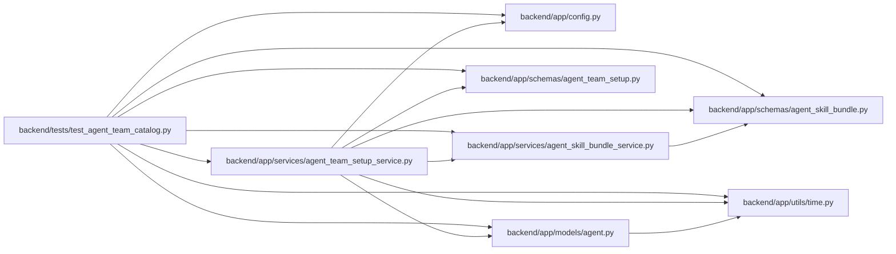

# test_agent_team_catalog Module

**Path:** `backend/tests/test_agent_team_catalog.py`

## Description

Team setup shares deployed bundle identities and integrity failures.

## Imports

| Source | Symbols |
|--------|---------|
| `__future__` | `annotations` |
| `app.config` | `get_settings` |
| `app.models.agent` | `AgentActor`, `AgentModelCatalogEntry` |
| `app.schemas.agent_skill_bundle` | `SkillBundleCatalogResponse` |
| `app.schemas.agent_team_setup` | `AgentTeamManifestRequest`, `AgentTeamMaster`, `AgentTeamPlanRequest` |
| `app.services.agent_skill_bundle_service` | `AgentSkillBundleService`, `SkillBundleArtifactError` |
| `app.services.agent_team_setup_service` | `AgentTeamSetupConflictError`, `AgentTeamSetupService` |
| `app.utils.time` | `utc_now` |
| `collections.abc` | `Iterator` |
| `json` | `json` |
| `pathlib` | `Path` |
| `pytest` | `pytest` |
| `shutil` | `shutil` |
| `sqlalchemy.ext.asyncio` | `AsyncSession` |

## Local dependency map

<!-- Auto-generated local dependency summary. Do not edit by hand. -->

### Internal neighbors

| Direction | Module |
|---|---|
| Outbound | [config](../modules/config.md) |
| Outbound | [models_agent](../modules/models_agent.md) |
| Outbound | [agent_skill_bundle](../modules/agent_skill_bundle.md) |
| Outbound | [agent_team_setup](../modules/agent_team_setup.md) |
| Outbound | [agent_skill_bundle_service](../modules/agent_skill_bundle_service.md) |
| Outbound | [agent_team_setup_service](../modules/agent_team_setup_service.md) |
| Outbound | [time](../modules/time.md) |

### External packages

| Language | Used packages | Undeclared packages |
|---|---:|---:|
| python | 2 | 1 |

## Functions

| Function | Signature | Decorators | Description |
|----------|-----------|------------|-------------|
| `deployed_release` | `(tmp_path: Path, monkeypatch: pytest.MonkeyPatch, agent_skill_artifact_root: Path) -> Iterator[Path]` | `@pytest.fixture` | — |
| `test_setup_uses_the_delivery_catalog_and_returns_independent_copies` | `(deployed_release: Path) -> None` | — | — |
| `test_setup_uses_an_explicit_release_service` | `(deployed_release: Path, tmp_path: Path, monkeypatch: pytest.MonkeyPatch) -> None` | — | — |
| `test_setup_and_delivery_fail_closed_on_damaged_release` | `(deployed_release: Path, monkeypatch: pytest.MonkeyPatch, damage: str) -> None` | `@pytest.mark.parametrize('damage', ['missing-directory', 'missing-checksums', 'invalid-catalog', 'invalid-checksums', 'archive', 'trust-pin'])` | — |
| `test_setup_revalidates_an_archive_changed_after_cache_population` | `(deployed_release: Path) -> None` | — | — |
| `test_deployed_catalog_supports_validation_and_bound_planning` | *(async)* `(deployed_release: Path, db_session: AsyncSession, tmp_path: Path, monkeypatch: pytest.MonkeyPatch) -> None` | `@pytest.mark.asyncio` | — |
