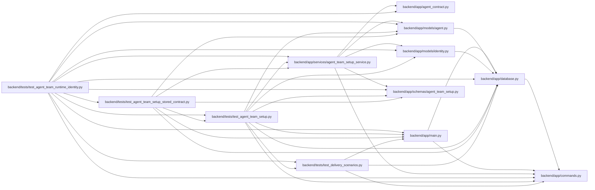

# test_agent_team_runtime_identity Module

**Path:** `backend/tests/test_agent_team_runtime_identity.py`

## Description

The onboarding handoff names a runtime instance and the acknowledgement must return it.

## Imports

| Source | Symbols |
|--------|---------|
| `__future__` | `annotations` |
| `app.agent_contract` | `AGENT_CONTRACT_FEATURES`, `RUNTIME_INSTANCE_IDENTITY_FEATURE`, `agent_contract_features` |
| `app.commands` | `command_transaction` |
| `app.database` | `get_db` |
| `app.main` | `app` |
| `app.models.agent` | `AgentTeamTopologyMember` |
| `app.models.identity` | `CommandAudit` |
| `app.schemas.agent_team_setup` | `AgentTeamMaster`, `AgentTeamRuntimeAcknowledgement`, `AgentTeamRuntimeHandoff` |
| `app.services.agent_team_setup_service` | `AgentTeamSetupConflictError`, `AgentTeamSetupService`, `_digest` |
| `datetime` | `datetime`, `timezone` |
| `httpx` | `httpx` |
| `json` | `json` |
| `pytest` | `pytest` |
| `sqlalchemy` | `select` |
| `sqlalchemy.ext.asyncio` | `AsyncSession` |
| `tests.test_agent_team_setup` | `CapturingCredentialSink`, `example_payload`, `operator` |
| `tests.test_agent_team_setup_stored_contract` | `TOPOLOGY_KEY`, `apply_every_action`, `member_records`, `store_team` |
| `tests.test_delivery_scenarios` | `delivery_store` |

## Local dependency map

<!-- Auto-generated local dependency summary. Do not edit by hand. -->

### Internal neighbors

| Direction | Module |
|---|---|
| Outbound | [agent_contract](../modules/agent_contract.md) |
| Outbound | [commands](../modules/commands.md) |
| Outbound | [app_database](../modules/app_database.md) |
| Outbound | [app_main](../modules/app_main.md) |
| Outbound | [models_agent](../modules/models_agent.md) |
| Outbound | [models_identity](../modules/models_identity.md) |
| Outbound | [agent_team_setup](../modules/agent_team_setup.md) |
| Outbound | [agent_team_setup_service](../modules/agent_team_setup_service.md) |
| Outbound | [test_agent_team_setup](../modules/test_agent_team_setup.md) |
| Outbound | [test_agent_team_setup_stored_contract](../modules/test_agent_team_setup_stored_contract.md) |
| Outbound | [test_delivery_scenarios](../modules/test_delivery_scenarios.md) |

### External packages

| Language | Used packages | Undeclared packages |
|---|---:|---:|
| python | 3 | 1 |

## Classes

| Class | Line | Bases | Description |
|-------|------|-------|-------------|
| [SameReceiptSink](../entities/SameReceiptSink.md) | 42 | `CapturingCredentialSink` | A sink whose delivery receipt does not change between deliveries, and that can lose one. |

## Functions

| Function | Signature | Decorators | Description |
|----------|-----------|------------|-------------|
| `worker_manifest` | `(**changes: str) -> AgentTeamMaster` | — | — |
| `acknowledgement_for` | `(handoff: AgentTeamRuntimeHandoff, *, identity: str \| None = None, features: tuple[str, ...] \| None = None, **extra) -> AgentTeamRuntimeAcknowledgement` | — | — |
| `worker_status` | *(async)* `(service: AgentTeamSetupService)` | — | — |
| `stored` | *(async)* `(db: AsyncSession) -> AgentTeamTopologyMember` | — | — |
| `team` | *(async)* `(db: AsyncSession)` | — | — |
| `test_feature_is_advertised_and_a_legacy_acknowledgement_keeps_its_bytes` | `() -> None` | `@pytest.mark.contract` | — |
| `test_handoff_carries_an_identity_and_a_matching_acknowledgement_shows_it` | *(async)* `(db_session: AsyncSession) -> None` | — | — |
| `test_other_member_handoffs_carry_their_own_identity` | *(async)* `(db_session: AsyncSession) -> None` | — | — |
| `test_a_mismatched_identity_is_refused_by_name_and_shown` | *(async)* `(db_session: AsyncSession) -> None` | — | — |
| `test_the_refusal_must_run_before_the_request_writes_anything` | *(async)* `(db_session: AsyncSession) -> None` | — | — |
| `test_a_member_without_an_issued_identity_does_not_fail_the_team_status` | *(async)* `(db_session: AsyncSession) -> None` | — | — |
| `test_a_refusal_ends_when_the_genuine_runtime_that_had_acknowledged_acknowledges_again` | *(async)* `(db_session: AsyncSession) -> None` | — | — |
| `test_a_replay_without_the_identity_does_not_end_a_refusal` | *(async)* `(db_session: AsyncSession) -> None` | — | — |
| `test_a_legacy_acknowledgement_is_accepted_and_reads_as_identity_unknown` | *(async)* `(db_session: AsyncSession) -> None` | — | — |
| `test_a_legacy_runtime_adopts_the_identity_by_refreshing_without_a_change` | *(async)* `(db_session: AsyncSession) -> None` | — | — |
| `test_a_runtime_that_lists_the_feature_must_send_the_identity` | *(async)* `(db_session: AsyncSession) -> None` | — | — |
| `test_a_required_feature_refuses_an_acknowledgement_without_the_identity` | *(async)* `(db_session: AsyncSession) -> None` | — | — |
| `test_a_replaced_member_issues_a_new_identity_and_the_takeover_is_a_visible_change` | *(async)* `(db_session: AsyncSession) -> None` | — | — |
| `test_a_recovered_credential_issues_a_new_identity` | *(async)* `(db_session: AsyncSession) -> None` | — | — |
| `test_an_acknowledgement_under_an_earlier_identity_is_stale_and_only_a_match_is_current` | `() -> None` | — | — |
| `test_a_runtime_without_the_field_taking_the_seat_is_a_visible_change` | *(async)* `(db_session: AsyncSession) -> None` | — | — |
| `test_the_identity_is_not_shown_in_the_redacted_report_counts` | *(async)* `(db_session: AsyncSession) -> None` | — | — |
| `test_identity_flow_on_each_database` | *(async)* `(delivery_store) -> None` | — | — |
| `acknowledge_over_http` | *(async)* `(db: AsyncSession, key: str, acknowledgement: AgentTeamRuntimeAcknowledgement)` | — | Post one acknowledgement through the REST route, inside the request transaction production uses. |
| `test_a_refusal_over_http_names_its_code_and_stays_visible` | *(async)* `(db_session: AsyncSession) -> None` | — | — |
