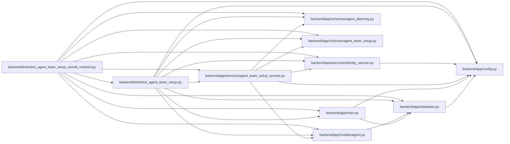

# test_agent_team_setup_stored_contract Module

**Path:** `backend/tests/test_agent_team_setup_stored_contract.py`

## Description

A team stored under earlier role rules stays readable and replaceable.

## Imports

| Source | Symbols |
|--------|---------|
| `__future__` | `annotations` |
| `app.config` | `get_settings` |
| `app.database` | `get_db` |
| `app.main` | `app` |
| `app.models.agent` | `AgentActor`, `AgentModelBinding`, `AgentModelCatalogEntry`, `AgentTeamTopology`, `AgentTeamTopologyMember` |
| `app.schemas` | `agent_team_setup` |
| `app.schemas.agent_planning` | `AgentPlanningCommandContext` |
| `app.schemas.agent_team_setup` | `AgentTeamApplyRequest`, `AgentTeamApplyResponse`, `AgentTeamCurrentMember`, `AgentTeamCurrentSnapshot`, `AgentTeamMaster`, `AgentTeamMemberSpec`, `AgentTeamPlanRequest`, `AgentTeamReconciliationClass`, `AgentTeamRuntimeAcknowledgement`, `AgentTeamRuntimeHandoff`, `load_stored_agent_team_master`, `load_stored_agent_team_member` |
| `app.services` | `agent_team_setup_service` |
| `app.services.agent_team_setup_service` | `AgentTeamSetupConflictError`, `AgentTeamSetupService` |
| `app.services.identity_service` | `initialize_control_plane` |
| `collections.abc` | `AsyncIterator`, `Iterator` |
| `contextlib` | `asynccontextmanager`, `contextmanager` |
| `copy` | `deepcopy` |
| `dataclasses` | `dataclass` |
| `httpx` | `httpx` |
| `json` | `json` |
| `pydantic` | `ValidationError` |
| `pytest` | `pytest` |
| `sqlalchemy` | `select` |
| `sqlalchemy.ext.asyncio` | `AsyncSession` |
| `sqlalchemy.orm` | `selectinload` |
| `tests.test_agent_team_setup` | `CapturingCredentialSink`, `example_payload`, `operator` |
| `typing` | `Any` |

## Local dependency map

<!-- Auto-generated local dependency summary. Do not edit by hand. -->

### Internal neighbors

| Direction | Module |
|---|---|
| Outbound | [config](../modules/config.md) |
| Outbound | [app_database](../modules/app_database.md) |
| Outbound | [app_main](../modules/app_main.md) |
| Outbound | [models_agent](../modules/models_agent.md) |
| Outbound | [schemas_agent_planning](../modules/schemas_agent_planning.md) |
| Outbound | [agent_team_setup](../modules/agent_team_setup.md) |
| Outbound | [agent_team_setup_service](../modules/agent_team_setup_service.md) |
| Outbound | [identity_service](../modules/identity_service.md) |
| Outbound | [test_agent_team_setup](../modules/test_agent_team_setup.md) |

### External packages

| Language | Used packages | Undeclared packages |
|---|---:|---:|
| python | 4 | 1 |

## Classes

| Class | Line | Bases | Description |
|-------|------|-------|-------------|
| [FailingForOneMemberSink](../entities/FailingForOneMemberSink.md) | 123 | `CapturingCredentialSink` | Lose the first credential delivery for one chosen member. |
| [EarlierTeam](../entities/EarlierTeam.md) | 236 | — | — |

## Functions

| Function | Signature | Decorators | Description |
|----------|-----------|------------|-------------|
| `team_payload` | `() -> dict[str, Any]` | — | Return the example team with a second verifier. |
| `earlier_team_payload` | `(package_name: str) -> dict[str, Any]` | — | Return the same team with every verifier on another role's package. |
| `earlier_role_rules` | `(package_name: str) -> Iterator[None]` | `@contextmanager` | Validate like a release whose verifiers carried ``package_name``. |
| `stored_text` | `(value: Any) -> str` | — | Serialize a contract the way an apply stores it. |
| `apply_every_action` | *(async)* `(service: AgentTeamSetupService, manifest: AgentTeamMaster, *, expected_revision: int, key: str, only: tuple[str, ...] \| None = None) -> AgentTeamApplyResponse` | — | Approve and confirm the planned actions, or just the ``only`` ones. |
| `store_team` | *(async)* `(db: AsyncSession, payload: dict[str, Any], *, key: str, sink: CapturingCredentialSink \| None = None) -> tuple[AgentTeamSetupService, CapturingCredentialSink]` | — | — |
| `store_team_under_earlier_rules` | *(async)* `(db: AsyncSession, package_name: str, *, acknowledged: bool = False) -> EarlierTeam` | — | Apply a team as the earlier release did, then return to today's rules. |
| `stored_topology` | *(async)* `(db: AsyncSession) -> AgentTeamTopology` | — | — |
| `member_records` | *(async)* `(db: AsyncSession) -> dict[str, AgentTeamTopologyMember]` | — | — |
| `identity_evidence` | `(records: dict[str, AgentTeamTopologyMember]) -> dict[str, Any]` | — | Return what an in-place contract update has to leave untouched. |
| `acknowledgement_for` | `(handoff: AgentTeamRuntimeHandoff) -> AgentTeamRuntimeAcknowledgement` | — | — |
| `test_stored_contract_keeps_shape_checks_and_names_the_broken_role_rule` | `() -> None` | `@pytest.mark.contract` | — |
| `operator_client` | *(async)* `(db: AsyncSession, monkeypatch: pytest.MonkeyPatch) -> AsyncIterator[httpx.AsyncClient]` | `@asynccontextmanager` | Call the public interface as an operator on the test database. |
| `test_status_names_contracts_stored_under_earlier_role_rules` | *(async)* `(db_session: AsyncSession, monkeypatch: pytest.MonkeyPatch, package_name: str) -> None` | `@pytest.mark.asyncio`, `@pytest.mark.parametrize('package_name', EARLIER_VERIFIER_PACKAGES)` | — |
| `test_plan_and_apply_replace_contracts_stored_under_earlier_role_rules` | *(async)* `(db_session: AsyncSession, monkeypatch: pytest.MonkeyPatch, package_name: str) -> None` | `@pytest.mark.asyncio`, `@pytest.mark.parametrize('package_name', EARLIER_VERIFIER_PACKAGES)` | — |
| `test_outdated_stored_contract_keeps_only_its_own_member_out` | *(async)* `(db_session: AsyncSession, package_name: str) -> None` | `@pytest.mark.asyncio`, `@pytest.mark.parametrize('package_name', EARLIER_VERIFIER_PACKAGES)` | — |
| `test_working_team_stored_under_earlier_role_rules_recovers_in_place` | *(async)* `(db_session: AsyncSession) -> None` | `@pytest.mark.asyncio` | — |
| `test_partly_approved_replacement_leaves_the_rest_plannable` | *(async)* `(db_session: AsyncSession) -> None` | `@pytest.mark.asyncio` | — |
| `test_lost_credential_on_an_outdated_contract_recovers_and_updates_it` | *(async)* `(db_session: AsyncSession) -> None` | `@pytest.mark.asyncio` | — |
| `test_lost_credential_recovery_still_changes_only_the_credential` | *(async)* `(db_session: AsyncSession) -> None` | `@pytest.mark.asyncio` | — |
| `test_current_stored_team_reads_exactly_as_with_strict_validation` | *(async)* `(db_session: AsyncSession, monkeypatch: pytest.MonkeyPatch) -> None` | `@pytest.mark.asyncio` | — |
