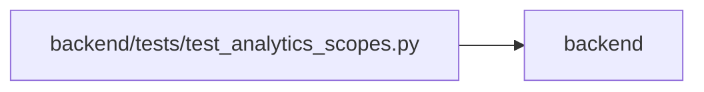

# test_analytics_scopes Module

**Path:** `backend/tests/test_analytics_scopes.py`

## Description

Report scopes aggregate recorded facts and retain legacy query behavior.

## Imports

| Source | Symbols |
|--------|---------|
| `app.authority` | `Authority` |
| `app.main` | `app` |
| `app.models.agent` | `AgentActor`, `AgentRun` |
| `app.models.delivery_observation` | `DeliveryObservation` |
| `app.models.execution_usage` | `ExecutionUsageRecord` |
| `app.models.iteration` | `Iteration` |
| `app.models.task` | `Task` |
| `app.schemas.execution_usage` | `ExecutionUsageWrite` |
| `app.services.delivery_metrics_service` | `DeliveryMetricsService` |
| `app.services.execution_usage_service` | `ExecutionUsageService` |
| `app.utils.time` | `utc_now` |
| `datetime` | `timedelta` |
| `decimal` | `Decimal` |
| `httpx` | `httpx` |
| `pytest` | `pytest` |
| `pytest_asyncio` | `pytest_asyncio` |
| `sqlalchemy` | `delete` |
| `tests.test_delivery_scenarios` | `delivery_store` |

## Local dependency map

<!-- Auto-generated local dependency summary. Do not edit by hand. -->

> Module-level dependencies exceed the generated-diagram limits, so the diagram and table below group them by top-level package. Counts report the number of module neighbors in each package.

### Internal neighbors

| Direction | Module |
|---|---|
| Outbound | `backend` (12) |

### External packages

| Language | Used packages | Undeclared packages |
|---|---:|---:|
| python | 4 | 2 |

> All 12 module neighbor(s) are summarized by package because the module-level view exceeds the 12-node limit.

## Functions

| Function | Signature | Decorators | Description |
|----------|-----------|------------|-------------|
| `report_store` | *(async)* `(delivery_store, monkeypatch)` | `@pytest_asyncio.fixture` | — |
| `test_reports_aggregate_matching_scope_and_preserve_existing_parameters` | *(async)* `(report_store, scope, accepted, median_days, cost, runs, missing)` | `@pytest.mark.parametrize('scope,accepted,median_days,cost,runs,missing', [('backlog', 3, 2, 9, 3, 0), ('all', 5, 3, 39, 6, 1), ('project', 4, 2.5, 19, 4, 0), ('iteration', 1, 10, 10, 1, 0), ('both', 1, 10, 10, 1, 0), ('workspace_backlog', 4, 2.5, 29, 4, 0)])` | — |
| `test_workspace_reports_keep_authorization_and_recorded_backlog_scope` | *(async)* `(report_store)` | — | — |
| `test_report_reads_reject_missing_or_conflicting_scope` | *(async)* `(delivery_store, params)` | `@pytest.mark.parametrize('params', [{}, {'backlog': True}, {'backlog': True, 'project_id': 1, 'iteration_id': 1}, {'all_projects': True, 'project_id': 1}, {'all_projects': True, 'iteration_id': 1}, {'all_projects': True, 'backlog': True}, {'all_projects_backlog': True}, {'all_projects_backlog': True, 'project_id': 1}, {'all_projects': True, 'all_projects_backlog': True, 'iteration_id': 1}, {'all_projects': True, 'all_projects_backlog': True, 'project_id': 1}, {'all_projects': True, 'all_projects_backlog': True, 'backlog': True}])` | — |
| `test_workspace_reports_preserve_window_and_empty_backlog` | *(async)* `(delivery_store, monkeypatch)` | — | — |
| `test_deleted_iteration_history_does_not_become_backlog` | *(async)* `(delivery_store)` | — | — |
