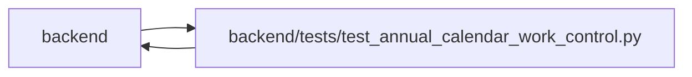

# test_annual_calendar_work_control Module

**Path:** `backend/tests/test_annual_calendar_work_control.py`

## Description

Annual planning inputs and execution authority are independently fenced.

The PostgreSQL writer-order cases run independent dispatch and annual-selection transactions and observe their blocker from a separate read connection. They verify the selected policy, one queued assignment, and an unchanged task version in both orders for iteration and personal calendars.

## Imports

| Source | Symbols |
|--------|---------|
| `app` | `mcp_server` |
| `app.authority` | `internal_authority` |
| `app.commands` | `AggregateVersionConflict`, `PlanningConflict`, `command_transaction`, `lock_planning` |
| `app.config` | `get_settings` |
| `app.main` | `app` |
| `app.models.agent` | `AgentModelCatalogEntry`, `AgentRun`, `AgentTaskAssignment` |
| `app.models.calendar` | `Calendar` |
| `app.models.capacity` | `ProfileAvailability` |
| `app.models.identity` | `Principal`, `ProjectMembership`, `WorkspaceMembership` |
| `app.models.iteration` | `Iteration` |
| `app.models.project` | `Project` |
| `app.models.task` | `Task` |
| `app.schemas.agent` | `AgentTaskAssignmentCreate` |
| `app.schemas.agent_planning` | `AgentPlanningCommandContext` |
| `app.schemas.iteration` | `IterationUpdate` |
| `app.services.agent_planning_service` | `AgentPlanningService` |
| `app.services.agent_service` | `AgentService` |
| `app.services.agent_work_service` | `AgentWorkService` |
| `app.services.capacity_service` | `CapacityService` |
| `app.services.identity_service` | `IdentityService`, `initialize_control_plane` |
| `app.services.iteration_service` | `IterationService` |
| `asyncio` | `asyncio` |
| `datetime` | `date` |
| `httpx` | `httpx` |
| `json` | `json` |
| `pytest` | `pytest` |
| `sqlalchemy` | `select`, `text` |
| `tests` | `test_team_pm_dispatch` |
| `tests.test_agent_team_setup_qualification` | `provision_ready_topology`, `routing_base` |
| `tests.test_execution_planning_window` | `planning_patch` |
| `tests.test_review_provenance_transports` | `databases`, `fence` |
| `tests.test_team_pm_recovery` | `recovery_api` |

## Local dependency map

<!-- Auto-generated local dependency summary. Do not edit by hand. -->

> Module-level dependencies exceed the generated-diagram limits, so the diagram and table below group them by top-level package. Counts report the number of module neighbors in each package.

### Internal neighbors

| Direction | Module |
|---|---|
| Inbound | `backend` (1) |
| Outbound | `backend` (26) |

### External packages

| Language | Used packages | Undeclared packages |
|---|---:|---:|
| python | 3 | 1 |

> All 27 module neighbor(s) are summarized by package because the module-level view exceeds the 12-node limit.

## Functions

| Function | Signature | Decorators | Description |
|----------|-----------|------------|-------------|
| `pm_headers` | `(key, receipt)` | — | — |
| `apply_inputs` | `(receipt)` | — | — |
| `calendar_edit` | *(async)* `(http, transport, key, iteration, revision, label, *, refused = False, **changes)` | — | — |
| `test_annual_selection_and_forecast_preserve_live_ownership` | *(async)* `(db_session, db_session_factory, team_member_factory, task_factory, monkeypatch, transport, lane)` | `@databases`, `@pytest.mark.parametrize('transport', ['rest', 'mcp'])`, `@pytest.mark.parametrize('lane', ['running', 'verification', 'rework'])`, `@pytest.mark.usefixtures('deployed_agent_skill_release')` | — |
| `test_mcp_reports_an_existing_issued_year_conflict` | *(async)* `(db_session, db_session_factory, team_member_factory, task_factory, monkeypatch, record_property)` | `@databases`, `@pytest.mark.usefixtures('deployed_agent_skill_release')` | Real team dispatch and an already protected supplemental-year removal exercise the error adapter. |
| `test_postgres_dispatch_serializes_with_supplemental_policy_replacement` | *(async)* `(db_session, db_session_factory, team_member_factory, task_factory, monkeypatch, owner, first_writer, record_property)` | `@pytest.mark.parametrize('db_session_factory', [pytest.param('postgresql', marks=[pytest.mark.postgresql, pytest.mark.allow_network])], indirect=True)`, `@pytest.mark.parametrize('owner', ['iteration', 'person'])`, `@pytest.mark.parametrize('first_writer', ['calendar', 'dispatch'])`, `@pytest.mark.usefixtures('deployed_agent_skill_release')` | — |