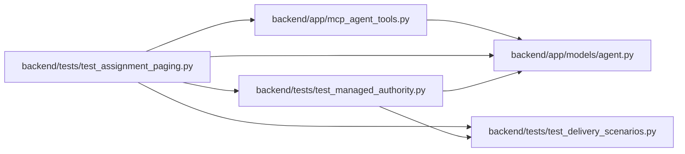

# test_assignment_paging Module

**Path:** `backend/tests/test_assignment_paging.py`

## Description

The paged assignment listing reads every row in the plain listing's order, within the same scope.

## Imports

| Source | Symbols |
|--------|---------|
| `app.mcp_agent_tools` | `list_agent_assignments_page` |
| `app.models.agent` | `AgentActor`, `AgentTaskAssignment` |
| `json` | `json` |
| `pytest` | `pytest` |
| `sqlalchemy` | `insert`, `update` |
| `tests.test_delivery_scenarios` | `delivery_store` |
| `tests.test_managed_authority` | `client`, `managed_store` |

## Local dependency map

<!-- Auto-generated local dependency summary. Do not edit by hand. -->

### Internal neighbors

| Direction | Module |
|---|---|
| Outbound | [mcp_agent_tools](../modules/mcp_agent_tools.md) |
| Outbound | [models_agent](../modules/models_agent.md) |
| Outbound | [test_delivery_scenarios](../modules/test_delivery_scenarios.md) |
| Outbound | [test_managed_authority](../modules/test_managed_authority.md) |

### External packages

| Language | Used packages | Undeclared packages |
|---|---:|---:|
| python | 2 | 1 |

## Functions

| Function | Signature | Decorators | Description |
|----------|-----------|------------|-------------|
| `seed_many` | *(async)* `(factory, scenario, *, per_task = 260)` | — | Closed assignments only, so the one-live-row-per-task rule does not apply. |
| `read_all` | *(async)* `(http, params = None, *, limit)` | — | — |
| `test_a_person_reads_more_than_five_hundred_assignments_without_gaps` | *(async)* `(managed_store)` | — | — |
| `test_small_pages_cover_the_plain_listing_and_keep_filters` | *(async)* `(managed_store)` | — | — |
| `test_an_agent_key_pages_its_own_queue_and_a_planner_pages_the_team` | *(async)* `(managed_store)` | — | — |
| `test_the_mcp_handler_pages_and_bounds_its_limit` | *(async)* `(managed_store)` | — | — |
| `test_rows_reranked_or_reassigned_between_pages_are_neither_skipped_nor_repeated` | *(async)* `(managed_store)` | — | — |
