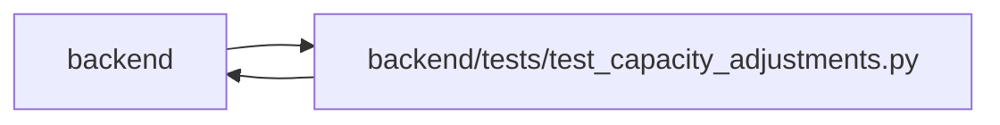

# test_capacity_adjustments Module

**Path:** `backend/tests/test_capacity_adjustments.py`

## Description

Dated capacity adjustments change capacity on their dates only and leave issued work current.

## Imports

| Source | Symbols |
|--------|---------|
| `app` | `database`, `mcp_server` |
| `app.config` | `get_settings` |
| `app.main` | `app` |
| `app.models.agent` | `AgentTaskAssignment` |
| `app.models.calendar` | `Calendar` |
| `app.models.capacity` | `PlanningState` |
| `app.models.identity` | `CommandAudit`, `ProjectMembership`, `WorkspaceMembership` |
| `app.models.iteration` | `Iteration` |
| `app.models.project` | `Project` |
| `app.models.recovery` | `ApplicationSnapshot` |
| `app.models.task` | `Task` |
| `app.models.team_member` | `TeamMember`, `TeamMemberCapacityAdjustment` |
| `app.services.agent_routing_service` | `AgentRoutingService` |
| `app.services.agent_service` | `hash_api_key` |
| `app.services.calendar_rules` | `AnnualCalendars` |
| `app.services.capacity_adjustments` | `DatedAvailability` |
| `app.services.capacity_service` | `PeriodCommitments` |
| `app.services.identity_service` | `IdentityService`, `initialize_control_plane` |
| `app.services.scheduler_service` | `SchedulerService` |
| `app.services.team_service` | `TeamService` |
| `asyncio` | `asyncio` |
| `contextlib` | `asynccontextmanager` |
| `datetime` | `date`, `timedelta` |
| `httpx` | `httpx` |
| `json` | `json` |
| `pytest` | `pytest` |
| `sqlalchemy` | `func`, `select` |
| `tests.test_iteration_date_move` | `human` |
| `tests.test_review_provenance` | `database_engines` |
| `tests.test_team_pm_dispatch` | `db_session_factory` |
| `types` | `SimpleNamespace` |

## Local dependency map

<!-- Auto-generated local dependency summary. Do not edit by hand. -->

> Module-level dependencies exceed the generated-diagram limits, so the diagram and table below group them by top-level package. Counts report the number of module neighbors in each package.

### Internal neighbors

| Direction | Module |
|---|---|
| Inbound | `backend` (1) |
| Outbound | `backend` (24) |

### External packages

| Language | Used packages | Undeclared packages |
|---|---:|---:|
| python | 3 | 1 |

> All 25 module neighbor(s) are summarized by package because the module-level view exceeds the 12-node limit.

## Functions

| Function | Signature | Decorators | Description |
|----------|-----------|------------|-------------|
| `restore_settings_cache` | `()` | `@pytest.fixture(autouse=True)` | — |
| `managed` | *(async)* `(db, db_session_factory, monkeypatch)` | — | — |
| `shared_person` | *(async)* `(db, profile_factory, team_member_factory)` | — | Two projects' iteration rows each reserve the whole of one person's day. |
| `headers` | `(context = None, **extra)` | — | — |
| `reduce_two_days` | `(percent = 0, **extra)` | — | — |
| `client` | *(async)* `()` | `@asynccontextmanager` | — |
| `person_days` | *(async)* `(api, profile_id, start = FIRST, end = THIRD)` | — | — |
| `test_preview_then_apply_lowers_one_row_on_two_dates_only` | *(async)* `(db_session, db_session_factory, profile_factory, team_member_factory, actor_factory, monkeypatch)` | `@database_engines` | — |
| `test_reducing_dates_of_issued_work_is_refused_without_staling_it` | *(async)* `(db_session, db_session_factory, profile_factory, team_member_factory, actor_factory, monkeypatch)` | `@database_engines` | — |
| `test_scheduler_and_capacity_honour_dated_adjustments` | *(async)* `(db_session, db_session_factory, profile_factory, team_member_factory)` | `@database_engines` | — |
| `test_mcp_planning_tools_preview_and_apply_one_receipt` | *(async)* `(db_session, db_session_factory, profile_factory, team_member_factory, actor_factory, monkeypatch)` | `@database_engines` | — |
| `test_adjustment_bounds_and_unused_allocation_removal` | *(async)* `(db_session, db_session_factory, profile_factory, team_member_factory, monkeypatch)` | `@database_engines` | — |
| `test_restoring_the_prior_snapshot_withdraws_the_adjustment_and_keeps_its_record` | *(async)* `(db_session, db_session_factory, profile_factory, team_member_factory, monkeypatch)` | `@database_engines` | — |
| `test_a_reduction_waits_for_a_concurrent_lock_on_the_rows_tasks` | *(async)* `(db_session, db_session_factory, profile_factory, team_member_factory, monkeypatch)` | `@pytest.mark.parametrize('db_session_factory', [pytest.param('postgresql', marks=[pytest.mark.postgresql, pytest.mark.allow_network])], indirect=True)` | Issuing work locks its task row first, so the reduction locks the same rows before reading assignments. |
| `test_viewers_and_managers_of_other_projects_cannot_adjust_capacity` | *(async)* `(db_session, db_session_factory, profile_factory, team_member_factory, monkeypatch)` | `@database_engines` | — |
| `test_saved_commitments_spread_by_the_percentage_on_each_date` | `()` | — | — |
