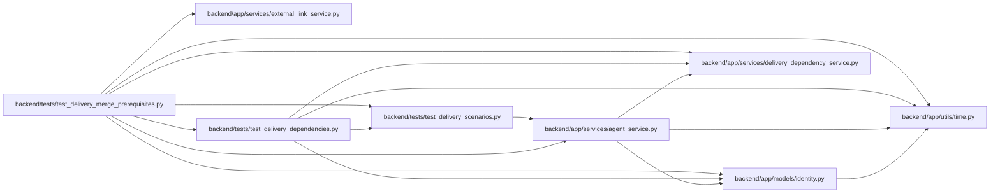

# test_delivery_merge_prerequisites Module

**Path:** `backend/tests/test_delivery_merge_prerequisites.py`

## Description

A delivery prerequisite can require accepted code merged on a named branch; the hold names who acts next.

## Imports

| Source | Symbols |
|--------|---------|
| `app.models.identity` | `Principal` |
| `app.services.agent_service` | `AgentService` |
| `app.services.delivery_dependency_service` | `DeliveryDependencyService` |
| `app.services.external_link_service` | `ExternalLinkService` |
| `app.utils.time` | `utc_now` |
| `pytest` | `pytest` |
| `tests.test_delivery_dependencies` | `pair` |
| `tests.test_delivery_scenarios` | `delivery_store` |

## Local dependency map

<!-- Auto-generated local dependency summary. Do not edit by hand. -->

### Internal neighbors

| Direction | Module |
|---|---|
| Outbound | [models_identity](../modules/models_identity.md) |
| Outbound | [agent_service](../modules/agent_service.md) |
| Outbound | [delivery_dependency_service](../modules/delivery_dependency_service.md) |
| Outbound | [external_link_service](../modules/external_link_service.md) |
| Outbound | [time](../modules/time.md) |
| Outbound | [test_delivery_dependencies](../modules/test_delivery_dependencies.md) |
| Outbound | [test_delivery_scenarios](../modules/test_delivery_scenarios.md) |

### External packages

| Language | Used packages | Undeclared packages |
|---|---:|---:|
| python | 1 | 1 |

## Functions

| Function | Signature | Decorators | Description |
|----------|-----------|------------|-------------|
| `observe` | *(async)* `(db, task, number, *, status, base = 'main', merge = True)` | — | — |
| `accept` | *(async)* `(db, task)` | — | — |
| `hold` | *(async)* `(db, task_id)` | — | — |
| `test_implemented_prerequisite_with_open_pull_request_holds_with_reviewer` | *(async)* `(delivery_store)` | — | — |
| `test_accepted_prerequisite_absent_from_target_holds_with_pm` | *(async)* `(delivery_store)` | — | — |
| `test_verified_merge_on_target_releases_the_hold_and_ordinary_edges_are_unchanged` | *(async)* `(delivery_store)` | — | — |
| `test_merge_without_acceptance_never_releases_and_branch_is_validated` | *(async)* `(delivery_store)` | — | — |
| `test_pipeline_shows_the_hold_on_the_waiting_task` | *(async)* `(delivery_store)` | — | — |
